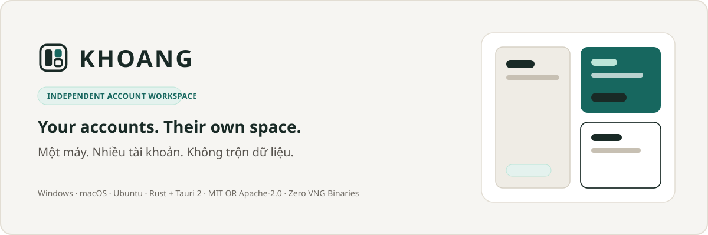
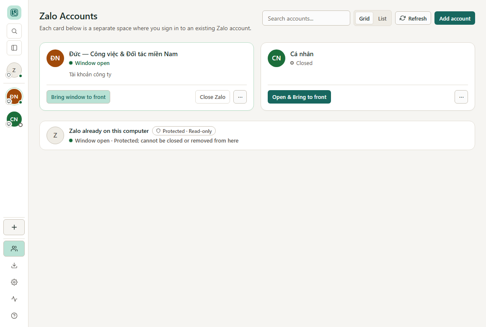
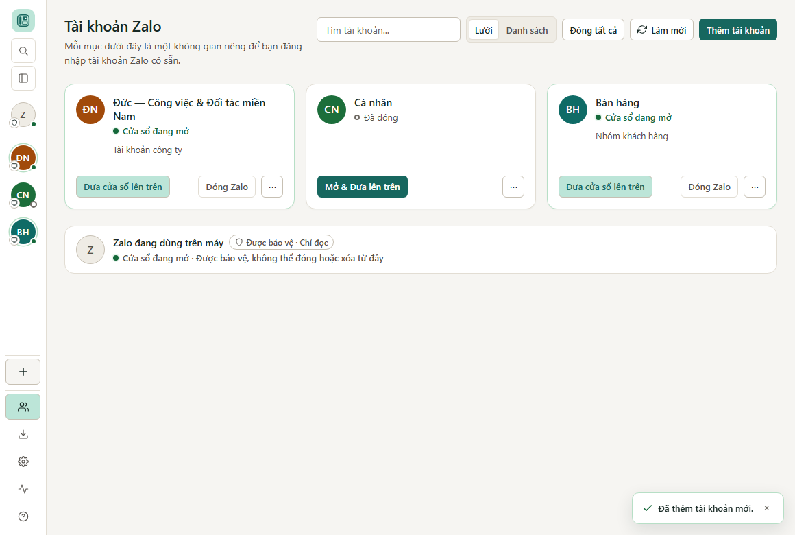
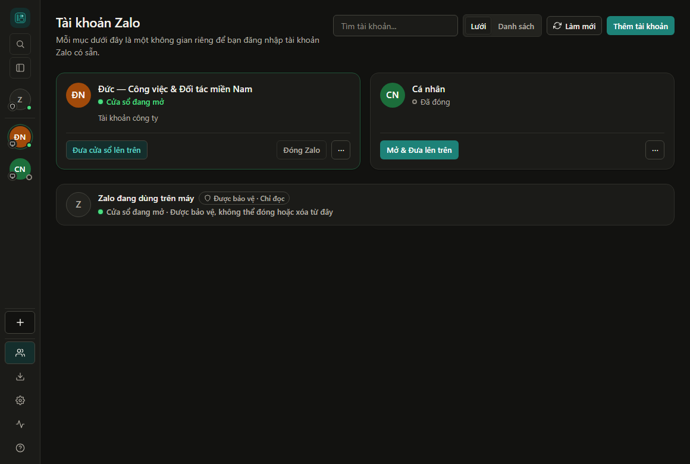
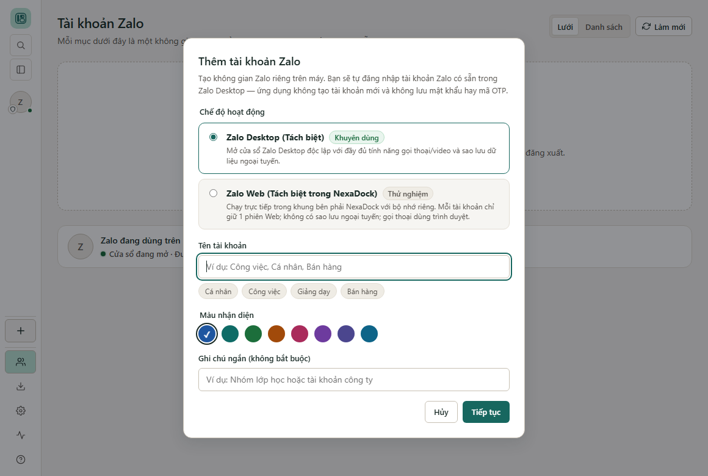
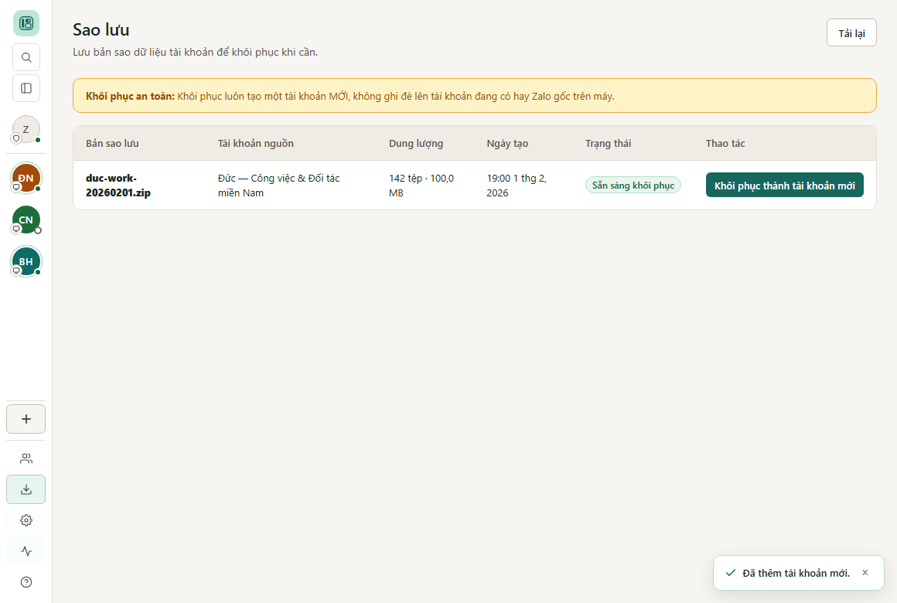
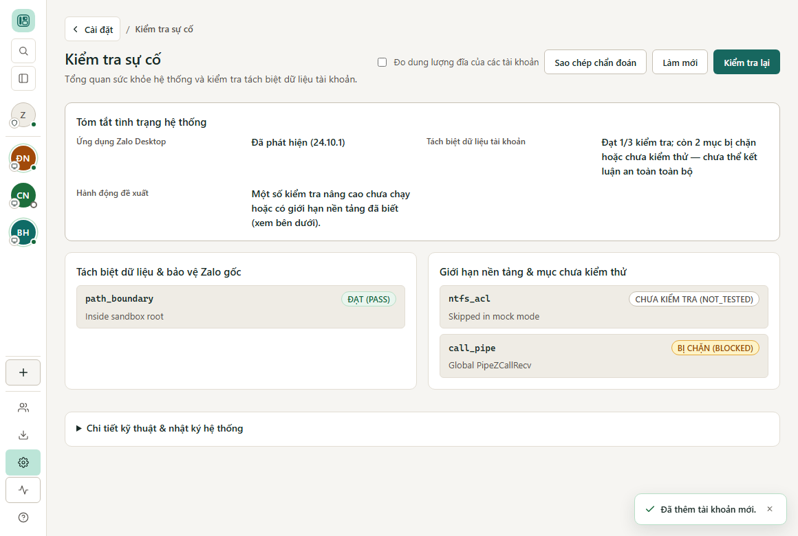

<div align="center">



<br />

# NexaDock

**Your accounts. Their own space.** *(Independent Account Workspace — cross-platform isolated multi-instance profile manager for Zalo Desktop on Windows, macOS, and Ubuntu)*

[Official Website](https://manhquydev.github.io/nexadock/en/) · [Tiếng Việt](README.md) · [Pre-release Downloads](https://github.com/manhquydev/nexadock/releases) · [Installation & Testing Guide (VI)](desktop-instance-manager/docs/release/huong-dan-cai-dat-va-kiem-thu-vi.md) · [Report an Issue](https://github.com/manhquydev/nexadock/issues)

[](https://github.com/manhquydev/nexadock/actions/workflows/ci.yml)


<br />



</div>

---

> [!IMPORTANT]
> **Non-Affiliation Notice:** **NexaDock** (`desktop-instance-manager`) is an independent open-source project (`MIT OR Apache-2.0`). It is **not affiliated with, sponsored by, or endorsed by VNG Corporation or Zalo**. `"Zalo"` is a trademark of VNG Corporation. This repository and its installers **never** bundle, patch, or redistribute proprietary VNG binaries — users install the official Zalo Desktop client directly from VNG.

---

## Overview

**NexaDock** lets you run and organize multiple isolated **Zalo Desktop** sessions side-by-side on a single machine **without interfering with your existing primary Zalo installation** (`%APPDATA%\ZaloData` on Windows or `~/Library/Application Support/ZaloData` on macOS).

Each account resides in its own dedicated space (`Profiles/<slug>_<id>/`) enforced via OS-level environment and filesystem redirection, managed through the **NexaDock** UI (Vietnamese & English, Light & Dark mode, *Calm Precision* design system — see [`docs/brand/BRAND_GUIDELINES.md`](docs/brand/BRAND_GUIDELINES.md)) built with **Rust + Tauri 2**.

> **Upgrade Compatibility:** NexaDock uses canonical `io.github.manhquydev.nexadock`, `%LOCALAPPDATA%\NexaDock`, and `nexadock-preferences.json`, and performs a safe, idempotent one-time migration from legacy `MultiZaloDesktop` / `khoang-preferences.json` (and `com.multizalodesktop.manager\EBWebView` on Windows) when `%LOCALAPPDATA%\NexaDock` does not yet exist, without deleting legacy data.

<details>
<summary><strong>More UI screenshots (Dark mode, Account creation wizard, Safe Backup &amp; Restore, Diagnostics)</strong></summary>

<br />

| Vietnamese Light Workspace | Dark Workspace |
| :---: | :---: |
|  |  |

| Create Account Space | Atomic Backup & Non-Destructive Restore |
| :---: | :---: |
|  |  |

| System Diagnostics & Isolation Audit |
| :---: |
|  |

</details>

---

## Key Features & Safety Guarantees

- **Primary Zalo Protection (`PROTECTED_PRIMARY_PROCESS` / `PROTECTED_PRIMARY_PATH`):** Your primary Zalo profile directory and running primary process are detected read-only and blocked from termination, modification, overwrite, or deletion.
- **Multi-Layer Per-Profile Isolation:** Separates user data, SQLite databases, caches, lockfiles, and temporary directories per profile (`APPDATA`/`LOCALAPPDATA`/`TEMP` on Windows; `CFFIXED_USER_HOME` + `SUN_LEN`-safe `TMPDIR` on macOS; `HOME`/`XDG_*` + optional `bwrap` on Linux).
- **Binary Integrity & External DB Guards:** Verifies Authenticode (`WinVerifyTrust` + `CN/O=VNG GROUP JSC`) on Windows, bundle signature identity on macOS, duplicate active `zalo_user_id` protection (`DUPLICATE_ZALO_USER_ID`), and `config.json -> db_path` traversal/cross-profile checks (`F-CORE-01`).
- **Causal Process-Tree Focus & Shutdown:** Uses Windows Restart Manager (`rstrtmgr.dll`) + `EnumWindows` / parameterized `osascript` without TCC prompts / Linux `/proc/<pid>/fd` WAL checks before escalation.
- **SHA-256 Verified Atomic Backup & Restore:** Requires at least `5 GiB + payload` free space before backup or restore and always restores backups into a **brand-new profile** without overwriting existing data.

---

## Cross-Platform Support & Verification Status

| Platform | Official VNG Client | NexaDock Status | Current Verification | Notes |
| :--- | :---: | :---: | :--- | :--- |
| **Windows 10 / 11 (`x86_64`)** | Yes (`Zalo.exe`) | **Supported & Verified (L1/L2)** | Full Rust workspace & `src-tauri` tests, PowerShell-vs-Rust parity, Tauri 2 native E2E (`12/12`), and `3` concurrent official `Zalo 26.10.20` windows alongside primary Zalo | Interactive **L3 2-account QR login** remains `NOT_TESTED` pending end-user verification; pre-release installers are `UNSIGNED_DEVELOPMENT_ARTIFACT`. |
| **Windows 11 Smart App Control (`SAC=1`)** | Yes (`Zalo.exe`) | **Supported via Signed-Host Bridge** | Tested under `SAC=1` via `ui-server.mjs` + `dim-host.ps1` | Unsigned `.exe`/`.msi` may be blocked by Smart App Control; run the **Signed-Host Bridge** via system-signed `powershell.exe` + `node.exe` instead of disabling SAC. |
| **macOS 11+ (`arm64` Apple Silicon; `WebIsolated` requires macOS 14+)** | Yes (`/Applications/Zalo.app`) | **Bundle & Automated Launch Verified / Pending Apple Developer ID & Live `Zalo.app` Test** | Native `macos-15` CI build (`arm64` `.dmg`), unit/scenario suites + `macos-release-acceptance.mjs` (bundle, Mach-O, dylibs, clean-install launch) | **Intel `x86_64` is not built in `release.yml`**; production DMG publishing is fail-closed pending Apple Developer ID & notarization secrets; **physical Mac & live `/Applications/Zalo.app` remain `NOT_TESTED`**. |
| **Ubuntu 22.04 / 24.04 LTS (`x86_64`)** | **No** (no VNG Linux build) | **Experimental (Manager + Local AppImage / Fixture)** | Native `ubuntu-24.04` CI `.deb` / `.AppImage` builds, `dim-platform-linux` (`46/46`) + `C2` fixture harness | **Official Zalo Desktop: `UNSUPPORTED`**. Intended for UI/adapter verification, synthetic fixtures, or user-supplied local AppImages. |

---

## Quick Installation & Verification

Download installers (**`v0.1.1-beta.3`**) from **[GitHub Releases](https://github.com/manhquydev/nexadock/releases)** and verify checksums against **`SHA256SUMS.txt`**.

- **Windows 10/11:** Run `NexaDock-0.1.1-beta.3-windows-x64-setup.exe` (or `.msi`). On machines with Smart App Control (`SAC=1`), launch from source with `cd desktop-instance-manager && node apps/desktop/ui-server.mjs`.
- **macOS (`arm64`):** Download `NexaDock-0.1.1-beta.3-macos-arm64.dmg`. Because the pre-release `.dmg` is unsigned/unnotarized, Gatekeeper blocks downloaded unsigned bundles by default; developers can run locally from source via `cargo run --manifest-path desktop-instance-manager/apps/desktop/src-tauri/Cargo.toml`.
- **Ubuntu 24.04 LTS (`x64`):** Install `NexaDock-0.1.1-beta.3-ubuntu24.04-amd64.deb` (`sudo apt-get install -y ./NexaDock-0.1.1-beta.3-ubuntu24.04-amd64.deb bubblewrap`) or execute `NexaDock-0.1.1-beta.3-linux-x86_64.AppImage`.

---

## Known Limitations

1. **Unsigned Development Pre-release (`UNSIGNED_DEVELOPMENT_ARTIFACT`):** Installers do not yet include Authenticode OV/EV or Apple Developer ID / Notarization signatures.
2. **Concurrent Voice/Video Calls (`ZaloCall`):** On Windows, `ZaloCall.exe` binds global Named Pipes (`PipeZCallRecv`/`PipeZCallSend`); on macOS, it unlinks global `/tmp/socketzalorecv2021`. Sequential calls work normally, while simultaneous calls across two instances are unsupported by the vendor client.
3. **Notification Grouping:** OS notifications share VNG's `AppUserModelId("com.vng.zalo")` / bundle identifier because official binaries remain unmodified.
4. **Ubuntu 24.04 AppArmor:** NexaDock never injects insecure `--no-sandbox` flags into Chromium/Electron AppImages.

---

## Building & Testing from Source

Requires **Rust `>= 1.85`** and **Node.js `22+`** (plus MSVC + WebView2 on Windows, or `libwebkit2gtk-4.1-dev libayatana-appindicator3-dev librsvg2-dev patchelf` on Ubuntu).

```bash
cd desktop-instance-manager
cargo fmt --all -- --check
cargo clippy --workspace --all-targets --locked -- -D warnings
cargo test --workspace --all-targets --locked
cargo check --manifest-path apps/desktop/src-tauri/Cargo.toml --locked
node tests/run-fixture-tests.mjs
node tests/run-contract-parity-tests.mjs
```

---

## License & Security

- **License:** Dual-licensed under **`MIT OR Apache-2.0`** ([LICENSE-MIT](LICENSE-MIT), [LICENSE-APACHE](LICENSE-APACHE)); third-party notices in [THIRD_PARTY_NOTICES.md](desktop-instance-manager/THIRD_PARTY_NOTICES.md).
- **Security Reporting:** See [SECURITY.md](SECURITY.md).
- **Contributing:** See [CONTRIBUTING.md](CONTRIBUTING.md).
