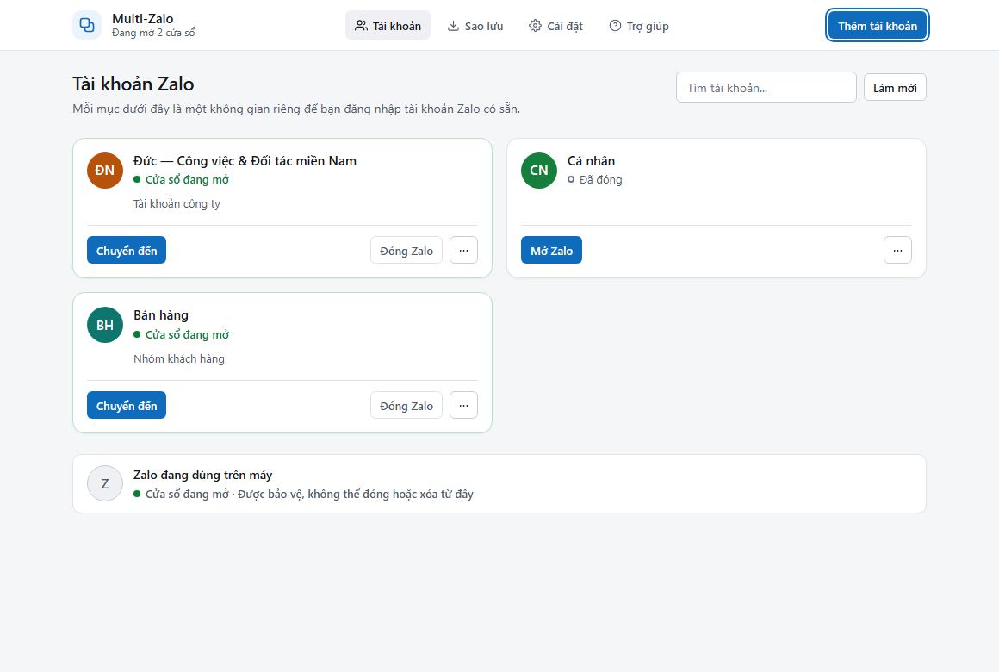
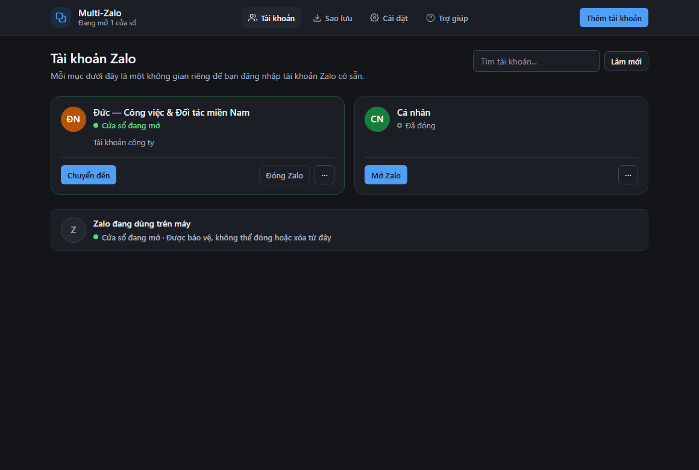
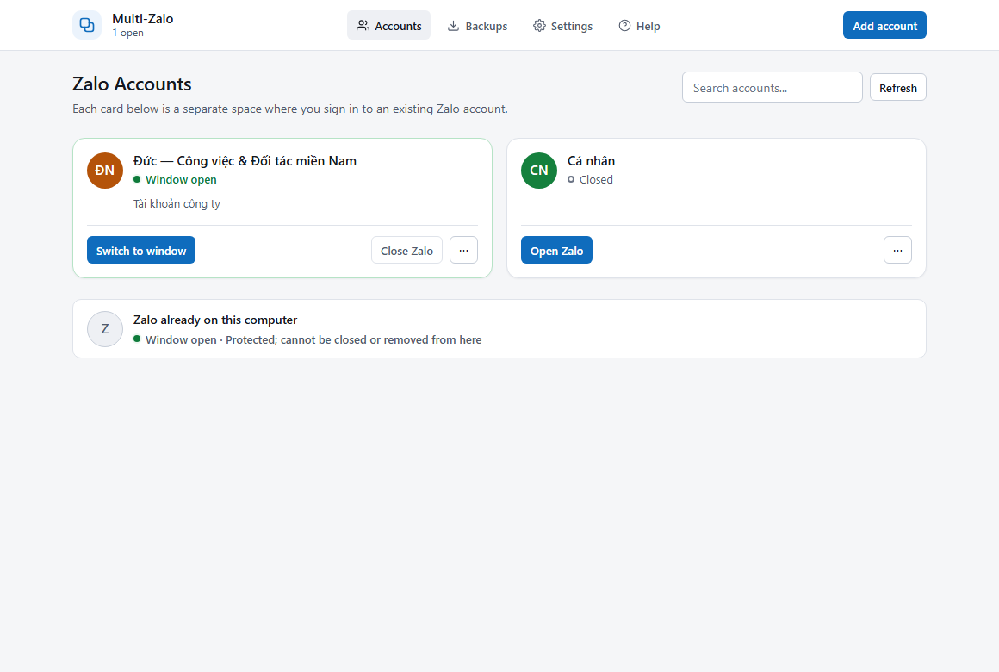
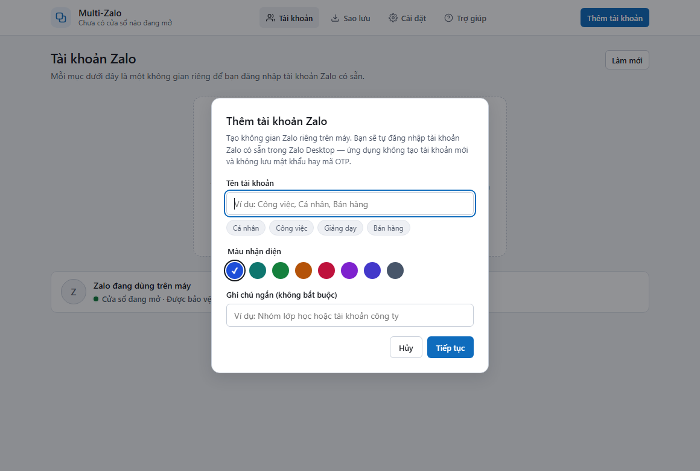
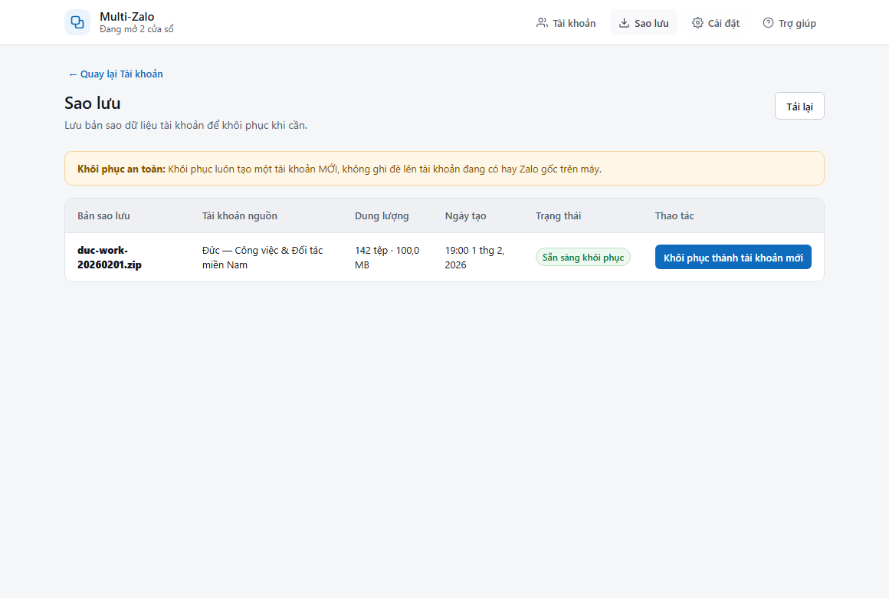
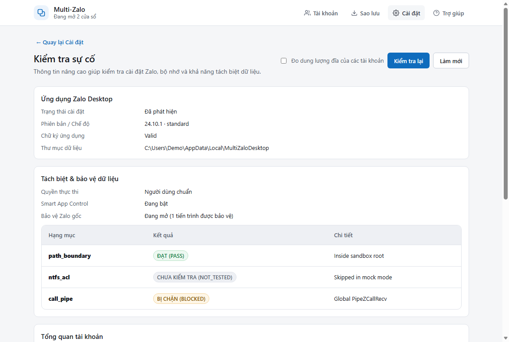

<div align="center">

# Multi-Zalo Desktop

**Trình quản lý đa tài khoản Zalo Desktop cô lập dữ liệu hoàn toàn trên Windows, macOS và Ubuntu**

[English README](README.en.md) · [Tải bản Pre-release](https://github.com/manhquydev/zalo/releases) · [Hướng dẫn cài đặt & kiểm thử](desktop-instance-manager/docs/release/huong-dan-cai-dat-va-kiem-thu-vi.md) · [Báo lỗi](https://github.com/manhquydev/zalo/issues)


<br />



</div>

---

> [!IMPORTANT]
> **Tuyên bố phi liên kết & nguyên tắc an toàn:** **Multi-Zalo Desktop** (`desktop-instance-manager`) là dự án mã nguồn mở độc lập (`MIT OR Apache-2.0`), **không liên kết, không được tài trợ hay chứng thực bởi VNG Corporation hay Zalo**. `"Zalo"` là nhãn hiệu của VNG Corporation. Kho mã nguồn và các gói cài đặt **không** đóng gói, không chỉnh sửa và không phân phối lại nhị phân của VNG — người dùng tự cài đặt ứng dụng Zalo Desktop chính thức từ nhà phát hành.

---

## Tổng quan

**Multi-Zalo Desktop** giúp bạn mở và quản lý nhiều tài khoản Zalo Desktop song song trên cùng một máy tính mà **không đụng chạm vào Zalo chính đang sử dụng**, không dùng bản crack hay sửa đổi tệp thực thi của VNG.

Mỗi tài khoản được đặt trong một không gian lưu trữ riêng (`Profiles/<slug>_<id>/`) bằng cơ chế tách biệt biến môi trường và thư mục dữ liệu ở cấp hệ điều hành, đi kèm giao diện **Account Dock** (Tiếng Việt / English, Sáng / Tối) xây dựng trên **Rust + Tauri 2**.

<details>
<summary><strong>Xem thêm ảnh chụp màn hình giao diện thực tế (Tối, Tiếng Anh, Thêm tài khoản, Sao lưu, Kiểm tra sự cố)</strong></summary>

<br />

| Giao diện tối (Dark Mode) | Giao diện Tiếng Anh (English) |
| :---: | :---: |
|  |  |

| Tạo không gian tài khoản | Sao lưu & Khôi phục an toàn |
| :---: | :---: |
|  |  |

| Kiểm tra sự cố & Chẩn đoán hệ thống |
| :---: |
|  |

</details>

---

## Tính năng cốt lõi & Bảo vệ dữ liệu

- **Tách biệt hoàn toàn khỏi Zalo gốc:** Tuyệt đối không đóng, không ghi đè, không xóa hoặc chạm vào dữ liệu tại `%APPDATA%\ZaloData` (Windows) hay `~/Library/Application Support/ZaloData` (macOS). Mọi thao tác nhắm vào tiến trình hoặc đường dẫn Zalo gốc đều bị chặn ở tầng Rust (`PROTECTED_PRIMARY_PROCESS` / `PROTECTED_PRIMARY_PATH`).
- **Chạy song song nhiều cửa sổ độc lập:** Cô lập cấu hình, cookie, database SQLite cục bộ và file lock riêng cho từng profile (`APPDATA`/`LOCALAPPDATA`/`TEMP` trên Windows; `CFFIXED_USER_HOME` + `TMPDIR` ngắn chuẩn `SUN_LEN` trên macOS; `HOME`/`XDG_*` + `bubblewrap` trên Linux).
- **Xác thực chữ ký ứng dụng gốc trước khi mở:** Trên Windows kiểm tra chữ ký Authenticode (`WinVerifyTrust` + `CN/O=VNG GROUP JSC`); trên macOS kiểm tra chữ ký bundle (`/Applications/Zalo.app`) không sửa đổi nhị phân gốc.
- **Ngăn mở trùng & chống sai lệch dữ liệu:** Phát hiện `zalo_user_id` trùng giữa các profile đang chạy (`DUPLICATE_ZALO_USER_ID`), kiểm tra `config.json -> db_path` trỏ chéo sang profile khác (`F-CORE-01`), cảnh báo và tự dọn lockfile treo sau sự cố (`recovery_required`).
- **Đóng đúng cây tiến trình & Chuyển cửa sổ nhanh:** Dùng Windows Restart Manager (`rstrtmgr.dll`) + `EnumWindows` / `osascript` không cần quyền trợ năng TCC / quét `/proc/<pid>/fd` trước khi dừng để tránh tắt ngang khi SQLite WAL đang mở.
- **Sao lưu nguyên tử & Khôi phục không ghi đè:** Tạo gói `.zip` kiểm tra bằng `SHA-256`, kiểm tra trống tối thiểu `5 GiB` trước khi sao lưu/khôi phục, và **luôn khôi phục thành một tài khoản mới độc lập**.

---

## Ma trận hỗ trợ hệ điều hành & Trạng thái kiểm chứng

> Bảng dưới đây phân tách trung thực giữa phần đã kiểm chứng trên hệ điều hành thật, phần kiểm thử bằng fixture/tự động, và phần chưa kiểm thử với tài khoản thật (`NOT_TESTED` / `UNSUPPORTED`).

| Nền tảng | Zalo Desktop chính thức | Trạng thái Multi-Zalo | Mức kiểm chứng hiện tại | Ghi chú quan trọng |
| :--- | :---: | :---: | :--- | :--- |
| **Windows 10 / 11 (`x86_64`)** | Có (`Zalo.exe`) | **Hoạt động & Đã kiểm chứng L1/L2** | `cargo test` workspace + `src-tauri`, parity `dim-cli.exe` / `dim-host.ps1`, Tauri 2 native E2E (`12/12`), chạy song song `3` cửa sổ `Zalo 26.10.20` cùng Zalo gốc | Kiểm thử **L3 quét QR 2 tài khoản thật** đang ở mức `NOT_TESTED` chờ nghiệm thu trên máy người dùng; bản cài đặt là `UNSIGNED_DEVELOPMENT_ARTIFACT`. |
| **Windows 11 bật Smart App Control (`SAC=1`)** | Có (`Zalo.exe`) | **Hoạt động qua Signed-Host Bridge** | Đã kiểm chứng trên máy bật `SAC=1` qua `ui-server.mjs` + `dim-host.ps1` | File `.exe`/`.msi` chưa ký số có thể bị `SAC=1` chặn; dùng trực tiếp **Signed-Host Bridge** từ mã nguồn (không tắt SAC). |
| **macOS 13–15 (`arm64` Apple Silicon & `x86_64` Intel)** | Có (`/Applications/Zalo.app`) | **Đã build & test fixture / Chờ test `Zalo.app` thật** | Đã biên dịch trên `macos-latest` (`arm64` `.dmg`), pass unit & scenario tests (`macos_scenarios` + `C2` fixture) | **Chưa kiểm thử đăng nhập tài khoản thật trên `/Applications/Zalo.app`** (`LIVE_ZALO_NOT_TESTED`), chưa ghim `TeamIdentifier` cố định, gói `.dmg` chưa Notarized. |
| **Ubuntu 22.04 / 24.04 LTS (`x86_64`)** | **Không** (VNG không phát hành bản Linux) | **Experimental (Manager + AppImage cục bộ / Fixture)** | Đã build `.deb` / `.AppImage` trên `ubuntu-24.04`, pass `dim-platform-linux` (`46/46`) + `C2` runtime fixture | **Official Zalo Desktop: `UNSUPPORTED`**. Chỉ dùng thử nghiệm Multi-Zalo Manager, fixture kiểm thử hoặc AppImage cục bộ do bạn tự cung cấp. |

---

## Cài đặt & Kiểm thử nhanh

Tải gói cài đặt mới nhất tại trang **[GitHub Releases (Pre-release)](https://github.com/manhquydev/zalo/releases)** và luôn đối chiếu mã băm với tệp **`SHA256SUMS.txt`** đi kèm trước khi chạy.

<details>
<summary><strong>1. Windows 10 / 11 (x64) — <code>.exe</code> / <code>.msi</code> / Signed-Host Bridge</strong></summary>

1. Tải **`Multi-Zalo-0.1.0-beta.1-windows-x64-setup.exe`** (khuyến nghị) hoặc **`Multi-Zalo-0.1.0-beta.1-windows-x64.msi`**.
2. Kiểm tra `SHA-256` bằng PowerShell:
   ```powershell
   Get-FileHash .\Multi-Zalo-0.1.0-beta.1-windows-x64-setup.exe -Algorithm SHA256
   ```
3. Cài đặt **Multi-Zalo Desktop**. Nếu Windows SmartScreen hiện cảnh báo do bản thử nghiệm chưa ký số Authenticode, hãy đối chiếu khớp `SHA-256` với `SHA256SUMS.txt` trước khi cho phép chạy (yêu cầu sẵn Microsoft Edge WebView2 Runtime).
4. **Trên máy bật Smart App Control (`SAC=1`):** Không tắt Smart App Control — chạy thẳng giao diện Account Dock qua PowerShell và Node.js đã được ký số của hệ thống:
   ```powershell
   cd desktop-instance-manager
   node apps/desktop/ui-server.mjs
   ```
5. Dữ liệu profile được lưu tách biệt tại `%LOCALAPPDATA%\MultiZaloDesktop`. Tài liệu kiểm thử chi tiết: [Hướng dẫn Windows & L3 QR](desktop-instance-manager/docs/release/huong-dan-cai-dat-va-kiem-thu-vi.md#1-hướng-dẫn-trên-windows-windows-10--11-x64).

</details>

<details>
<summary><strong>2. macOS (Apple Silicon arm64) — <code>.dmg</code></strong></summary>

1. Tải **`Multi-Zalo-0.1.0-beta.1-macos-arm64.dmg`** và kiểm tra `SHA-256`:
   ```bash
   shasum -a 256 Multi-Zalo-0.1.0-beta.1-macos-arm64.dmg
   ```
2. Đảm bảo đã cài sẵn `/Applications/Zalo.app` chính thức từ VNG.
3. **Lưu ý Gatekeeper:** Do bản Pre-release chưa có chứng chỉ Apple Developer ID / Notarization (`UNSIGNED_DEVELOPMENT_ARTIFACT`), macOS Gatekeeper mặc định có thể từ chối mở file nhị phân tải từ Internet. Để kiểm thử phát triển cục bộ mà không hạ cấp bảo mật hệ điều hành, có thể tự build từ mã nguồn với Xcode Command Line Tools & Rust:
   ```bash
   cd desktop-instance-manager
   cargo run --manifest-path apps/desktop/src-tauri/Cargo.toml
   ```
4. Xem hướng dẫn & danh sách kiểm tra phần cứng Mac: [macOS Live Checklist](desktop-instance-manager/docs/platform/macos/live-zalo-test-checklist.md).

</details>

<details>
<summary><strong>3. Ubuntu 24.04 LTS (x64) — <code>.deb</code> & <code>.AppImage</code></strong></summary>

1. Tải **`Multi-Zalo-0.1.0-beta.1-ubuntu24.04-amd64.deb`** hoặc **`Multi-Zalo-0.1.0-beta.1-linux-x86_64.AppImage`** và kiểm tra `SHA-256`:
   ```bash
   sha256sum -c SHA256SUMS.txt --ignore-missing
   ```
2. Cài đặt gói `.deb`:
   ```bash
   sudo apt-get update
   sudo apt-get install -y ./Multi-Zalo-0.1.0-beta.1-ubuntu24.04-amd64.deb bubblewrap
   ```
   Hoặc chạy bản `.AppImage`:
   ```bash
   chmod +x Multi-Zalo-0.1.0-beta.1-linux-x86_64.AppImage
   ./Multi-Zalo-0.1.0-beta.1-linux-x86_64.AppImage
   ```
3. **Lưu ý:** VNG không cung cấp Zalo Desktop cho Linux; bản Ubuntu dành cho chạy thử giao diện Account Dock (WebKitGTK 4.1), fixture kiểm thử vòng đời `bwrap`/`XDG_*` hoặc AppImage cục bộ. Xem chi tiết: [Ubuntu AppImage Compatibility](desktop-instance-manager/docs/platform/ubuntu/appimage-compatibility.md).

</details>

---

## Giới hạn kỹ thuật đã biết

1. **Chưa ký số phát hành công cộng (`UNSIGNED_DEVELOPMENT_ARTIFACT`):** Bộ cài hiện tại là bản Pre-release thử nghiệm chưa gắn chứng chỉ Authenticode OV/EV hay Apple Developer ID + Notarization.
2. **Cuộc gọi thoại / video đồng thời (`ZaloCall`):** Trên Windows, `ZaloCall.exe` dùng chung Named Pipe hệ thống (`\\.\pipe\PipeZCallRecv` và `PipeZCallSend`); trên macOS dùng socket cố định `/tmp/socketzalorecv2021` / `socketzalosend2021`. Bạn vẫn gọi từng cuộc gọi riêng lẻ bình thường, nhưng **không thể mở 2 cuộc gọi ZaloCall cùng một thời điểm**.
3. **Thông báo hệ thống:** Vì giữ nguyên `Zalo.exe` / `Zalo.app` không chỉnh sửa, Windows Action Center và macOS Notification Center có thể gom thông báo theo `AppUserModelId("com.vng.zalo")` hoặc Bundle ID gốc.
4. **Ubuntu 24.04 AppArmor:** Trên Ubuntu `24.04+` bật `kernel.apparmor_restrict_unprivileged_userns = 1`, Multi-Zalo **không** tự thêm cờ `--no-sandbox` kém an toàn khi chạy Electron/AppImage của người dùng.

---

## Biên dịch & Kiểm thử từ mã nguồn (Dành cho nhà phát triển)

Yêu cầu: **Rust `>= 1.85`** (Tauri 2 crate dùng `1.85+`), **Node.js `22+`**, trên Windows cần Visual Studio Build Tools (MSVC) & WebView2, trên Ubuntu cần `libwebkit2gtk-4.1-dev libayatana-appindicator3-dev librsvg2-dev patchelf`.

```bash
cd desktop-instance-manager

# Kiểm tra format, typecheck, clippy & toàn bộ Rust unit/integration tests
cargo fmt --all -- --check
cargo check --workspace --all-targets --locked
cargo clippy --workspace --all-targets --locked -- -D warnings
cargo test --workspace --all-targets --locked

# Kiểm tra Tauri desktop crate
cargo check --manifest-path apps/desktop/src-tauri/Cargo.toml --locked

# Chạy bộ test Node fixture & parity PowerShell/Rust (môi trường cô lập, không chạm ZaloData thật)
node tests/run-fixture-tests.mjs
node tests/run-contract-parity-tests.mjs
```

---

## Cấu trúc kho mã nguồn & Tài liệu

- [`desktop-instance-manager/`](desktop-instance-manager/) — Mã nguồn chính:
  - [`crates/core/`](desktop-instance-manager/crates/core/) · [`crates/profile-store/`](desktop-instance-manager/crates/profile-store/) · [`crates/process-manager/`](desktop-instance-manager/crates/process-manager/) — Core models, lưu trữ nguyên tử & backup SHA-256, hàng đợi vòng đời đa luồng.
  - [`crates/platform-windows/`](desktop-instance-manager/crates/platform-windows/) · [`crates/platform-macos/`](desktop-instance-manager/crates/platform-macos/) · [`crates/platform-linux/`](desktop-instance-manager/crates/platform-linux/) — Platform adapters theo từng hệ điều hành.
  - [`apps/desktop/`](desktop-instance-manager/apps/desktop/) — Tauri 2 shell (`src-tauri/`), giao diện Account Dock (`ui/`), và máy chủ Signed-Host Bridge (`ui-server.mjs`).
  - [`tests/`](desktop-instance-manager/tests/) · [`fixtures/`](desktop-instance-manager/fixtures/) — Bộ fixture cô lập và kiểm thử chéo nền tảng.
- [`multi-zalo-desktop/`](multi-zalo-desktop/) — Nguyên mẫu Windows PoC v1 (lưu trữ tham khảo lịch sử).
- **Tài liệu kỹ thuật chuyên sâu:**
  - [Hướng dẫn cài đặt & kiểm thử Pre-release (Tiếng Việt)](desktop-instance-manager/docs/release/huong-dan-cai-dat-va-kiem-thu-vi.md)
  - [Ma trận nghiệm thu đa nền tảng](desktop-instance-manager/docs/release/platform-acceptance-matrix.md) · [OS Readiness](desktop-instance-manager/docs/compatibility/os-readiness.md)
  - [Kiến trúc & Quyết định thiết kế (ADR-001 → ADR-004)](desktop-instance-manager/docs/architecture/adr-001-hybrid-isolation-architecture.md)
  - [Mô hình đe dọa & Kiểm toán bảo mật](desktop-instance-manager/docs/security/threat-model-and-audit.md) · [Bảo mật kho công khai](desktop-instance-manager/docs/security/public-audit/public-release-gate.md)
  - [Báo cáo kiểm thử PoC Zalo thật trên Windows](desktop-instance-manager/docs/testing/poc-and-test-report.md)

---

## Đóng góp, Bảo mật & Giấy phép

- Đóng góp mã nguồn: xem [CONTRIBUTING.md](CONTRIBUTING.md).
- Báo cáo lỗ hổng bảo mật: xem [SECURITY.md](SECURITY.md) (vui lòng không mở issue công khai cho lỗi bảo mật).
- Giấy phép: Mã nguồn trong `desktop-instance-manager/` được phát hành theo giấy phép kép **`MIT OR Apache-2.0`** ([LICENSE-MIT](LICENSE-MIT), [LICENSE-APACHE](LICENSE-APACHE)), kèm thông báo thư viện bên thứ ba tại [THIRD_PARTY_NOTICES.md](desktop-instance-manager/THIRD_PARTY_NOTICES.md).
