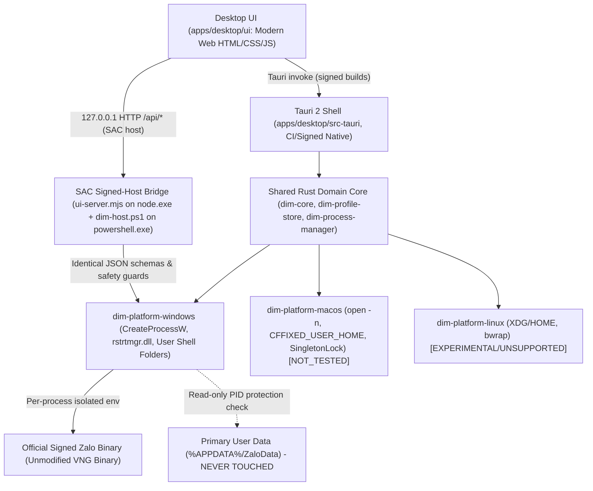

# ADR-001: Hybrid Isolation Architecture

**Status:** Accepted  
**Date:** 2026-11-17  
**Deciders:** `desktop-instance-manager` Architecture & Research Team  
**Related:** [platform-feasibility.md](../research/platform-feasibility.md) | [repository-comparison.md](../research/repository-comparison.md) | [ADR-002](./adr-002-rust-tauri-and-sac-host-bridge.md) | [ADR-003](./adr-003-process-ownership-and-graceful-shutdown.md) | [ADR-004](./adr-004-backup-restore-and-data-safety.md)

---

## 1. Context & Problem Statement

Official Zalo Desktop (`26.10.20`, Electron `22.3.9`) restricts users to a single active session per OS login because `bootstrap.js` loads `main-dist/migration.js` *before* `app.requestSingleInstanceLock()`, forcing `app.setPath("userData", path.join(app.getPath("appData"), "ZaloData"))`. Consequently, passing `--user-data-dir` alone is overwritten before Chromium acquires its single-instance lockfile (`lockfile` on Windows; `SingletonLock` on POSIX).

Any multi-instance manager must solve this while satisfying strict safety, legal, and maintainability invariants:
1. **Zero Binary Modification:** Never alter `Zalo.exe`, `Zalo.app`, `app.asar`, or VNG Authenticode/Apple notarization signatures.
2. **Primary Profile Non-Interference:** Never touch, move, swap, or terminate the user's primary `%APPDATA%\ZaloData` session (`PROTECTED_PRIMARY_PROCESS`).
3. **Standard User Privilege (`asInvoker`):** Require zero Administrator elevation, zero kernel drivers, and zero `HKLM` writes.
4. **Honest Cross-Platform Scope:** Strong Windows core isolation (`PARTIALLY_SUPPORTED`), clean macOS adapter blueprint (`NOT_TESTED`), and explicit rejection of proprietary ASAR extraction/redistribution on Linux (`UNSUPPORTED` for official Zalo; `EXPERIMENTAL` for test fixtures & user-supplied local AppImages).

---

## 2. Weighted Architectural Decision Matrix (Options A – E)

Weights reflect project priorities (`100%` total): Binary Integrity (`20%`), Primary Data Safety (`20%`), Least Privilege / Zero Drivers (`15%`), Windows SAC & Enterprise Compliance (`15%`), Zalo Auto-Update Resilience (`10%`), Cross-Platform Maintainability (`10%`), and Resource Overhead (`10%`).

> **Measurement Discipline:** Only Windows `26.10.20` core lifecycle latencies and memory figures from [`multi-zalo-desktop`](../../../multi-zalo-desktop/evidence/integration-test-result.json) (historical baseline) are measured (`~1.9–2.4s` startup, `~1.07 GB` WorkingSet/instance). **macOS runtime latency, Linux AppImage/`bwrap` overhead, Rust binary compile/startup benchmarks on Windows (no local `rustc`), and live multi-account call/notification telemetry are UNMEASURED** and explicitly excluded from fabricated numeric scoring.

| Criterion (Weight) | Option A: Simple Profile-Aware Launcher (Script-Only) | Option B: OS-Level Isolation (Kernel Sandbox / Secondary Logon / VM) | Option C: Installation Cloning (Duplicate `Zalo-*` Binaries) | Option D: Hybrid Rust Core + Tauri 2 + Platform Adapters + Windows SAC Signed-Host Bridge (**Selected**) | Option E: `app.asar` Patching / Runtime DLL Hooking (**Rejected**) |
| :--- | :---: | :---: | :---: | :---: | :---: |
| **Binary Integrity & Signature (20%)** | 5/5 (1.00) | 5/5 (1.00) | 4/5 (0.80) | **5/5 (1.00)** | 0/5 (0.00) — breaks VNG integrity |
| **Primary Data Safety & Guards (20%)** | 2/5 (0.40) — typically lacks backup/PID/redirection guards | 4/5 (0.80) | 1/5 (0.20) — still shares `%APPDATA%\ZaloData`! | **5/5 (1.00)** — immutable paths, atomic backup, `PROTECTED_PRIMARY_PROCESS` | 2/5 (0.40) |
| **Least Privilege / No Drivers (15%)** | 5/5 (0.75) | 1/5 (0.15) — Sandboxie needs Admin + `SbieDrv.sys` (`GPL-3.0`); `runas` needs OS creds | 5/5 (0.75) | **5/5 (0.75)** — strictly `asInvoker` user-mode | 3/5 (0.45) |
| **SAC & Enterprise Compliance (15%)** | 3/5 (0.45) — fails if unvalidated `.ps1` or unsigned `.exe` | 2/5 (0.30) — driver/hook conflicts under WDAC | 3/5 (0.45) | **5/5 (0.75)** — compliant Signed-Host Bridge + CI Authenticode path | 1/5 (0.15) |
| **Zalo Update Resilience (10%)** | 4/5 (0.40) | 3/5 (0.30) — sandbox overlays conflict with `Update.exe` | 1/5 (0.10) — clones go stale immediately | **5/5 (0.50)** — dynamic `Zalo-*` semver scan | 0/5 (0.00) — overwritten every update |
| **Cross-Platform Maintainability (10%)** | 2/5 (0.20) — OS-specific scripts drift | 1/5 (0.10) — kernel/OS mechanisms diverge | 2/5 (0.20) | **4.5/5 (0.45)** — shared `dim-core`/`dim-profile-store`/`dim-process-manager` traits | 1/5 (0.10) |
| **Resource Overhead (10%)** | 5/5 (0.50) | 2/5 (0.20) — VM/driver/user-profile load | 1/5 (0.10) — ~400+ MB duplicated binaries per profile | **4.5/5 (0.45)** — ~0% launcher overhead beyond real Zalo (`unmeasured` on macOS/Linux) | 5/5 (0.50) |
| **Weighted Score** | **3.70 / 5.00** | **2.85 / 5.00** | **2.60 / 5.00** | **4.90 / 5.00 (Selected)** | **1.60 / 5.00 (Rejected)** |

---

## 3. Selected Architecture (Option D)



### 3.1. Workspace & Crate Boundaries (`Cargo.toml`)

1. **`dim-core` (`crates/core/`):** Pure domain schemas (`ProfileRecord`, `ProfilesDocument`, `BackupManifest`, `SupportStatus`), traits (`ApplicationLocator`, `ProfileStore`, `InstanceLauncher`, `InstanceMonitor`, `PlatformCapabilities`, `BackupManager`, `RecoveryManager`), Vietnamese diacritic/`đ` -> `d` slug generator (`slug.rs`), `resolve_safe_child` path-traversal guard (`path_guard.rs`), `MIN_FREE_DISK_BYTES` (`5 GiB`) threshold, and duplicate `zalo_user_id` detector (`Database/_production/<6+ digits>`).
2. **`dim-profile-store` (`crates/profile-store/`):** Atomic `profiles.json.tmp` -> replace persistence, `.zalo-profile-id` marker verification, offline atomic backup (`.partial` -> `backup.json` with SHA-256 manifest), and restore-to-new-profile-only workflows.
3. **`dim-process-manager` (`crates/process-manager/`):** `PrimaryProtectionGuard` (`PROTECTED_PRIMARY_PROCESS`), platform `GracefulQuitSequence` coordination, and stale crash lockfile recovery (`RecoveryManager`).
4. **Platform Adapters (`crates/platform-windows/`, `crates/platform-macos/`, `crates/platform-linux/`):** Isolate all OS-specific Win32/Cocoa/POSIX FFI behind `dim-core` traits.
5. **Signed-Host Bridge (`scripts/dim-host.ps1` + `apps/desktop/ui-server.mjs`):** Mirrors the exact JSON schemas, directory layouts, and safety invariants inside Microsoft-signed `powershell.exe` + OpenJS-signed `node.exe` so Windows 11 hosts enforcing Smart App Control run full workflows immediately without local `rustc` or unsigned PE execution.

### 3.2. Isolated Data Layout & `profiles.json` Contract

Data root resolves to `%LOCALAPPDATA%\MultiZaloDesktop` (Windows), `~/Library/Application Support/MultiZaloDesktop` (macOS), or `$XDG_DATA_HOME/MultiZaloDesktop` (Linux), overridable via `DIM_DATA_DIR`:

- **`profiles.json` (Schema v1):**
  ```json
  {
    "schema_version": 1,
    "profiles": [
      {
        "id": "<8hex>",
        "name": "<display>",
        "directory_name": "<slug>_<8hex>",
        "created_at": "<RFC3339>",
        "last_launched_at": null,
        "zalo_user_id": null,
        "notes": ""
      }
    ]
  }
  ```
- **Windows Isolated Directory (`<data_dir>/Profiles/<slug>_<8hex>/`):**
  - `AppData/Roaming/zmeta.json` (`{"failedMigrateCount":0}`)
  - `AppData/Roaming/ZaloData/migrate-config.json` (`{"zalopc_m_c":true}`)
  - `AppData/Roaming/ZaloData/.zalo-profile-id` (`<8hex>`)
  - `AppData/Local/Temp/` (`TEMP` & `TMP` target)
  - `Documents/Zalo Received Files/` (isolated by default; optional host junctions must unlink before delete)
- **macOS Isolated Directory (`NOT_TESTED`):** `Library/Application Support/ZaloData/.zalo-profile-id`, `tmp/`, symlinks to host `Library/Keychains`, `Downloads`, `Desktop`, `Documents`, `Pictures`, `Movies`, `Music`.
- **Linux Isolated Directory (`EXPERIMENTAL`):** `.config/ZaloData/.zalo-profile-id`, `.local/share/`, `.cache/`, `tmp/`.

---

## 4. Consequences & Extension Trace

- **Positive:** Preserves VNG's signature and auto-update compatibility; prevents accidental primary Zalo disruption; keeps `dim-core` 100% testable without Win32 GUI/kernel dependencies; lets UI/E2E tests run today on SAC-enforcing Windows 11.
- **Accepted Trade-offs:** Concurrent Windows voice/video calls remain `BLOCKED` (`\\.\pipe\PipeZCallRecv`/`PipeZCallSend`); dual Rust + PowerShell host bridge requires contract parity testing (`tests/run-fixture-tests.mjs` and `scripts/run-zalo-poc.ps1`); Rust native binaries require CI + Authenticode signing before Gate F end-user distribution.
- **Extension Trace:** Adding another Electron desktop application using the same `app.getPath("appData")` single-instance pattern only requires implementing `ApplicationLocator` and app-specific pre-seed markers in the platform adapter; `ProfileStore`, `BackupManager`, `PrimaryProtectionGuard`, and `ui/` remain unchanged.
