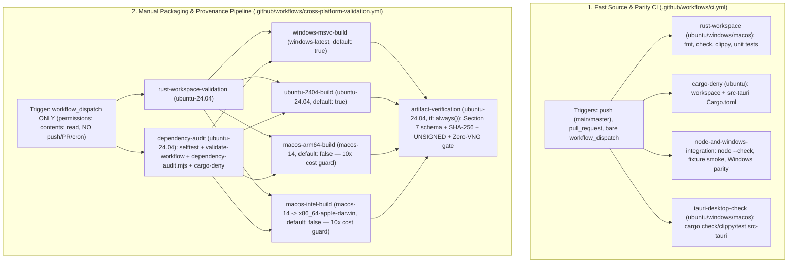

# Cross-Platform Build, Packaging & Provenance Matrix

**Document Owner:** Release Governance & Build Matrix Architecture  
**Applies To:** `desktop-instance-manager` (`Multi-Zalo Desktop` v`0.1.0`, `com.multizalodesktop.manager`)  
**Baseline Commit:** `a5feb4a520798064c1508c26fe4c4ac17a3a03cf` (`a5feb4a`)  
**Workflows Covered:** [`.github/workflows/ci.yml`](../../../.github/workflows/ci.yml) and [`.github/workflows/cross-platform-validation.yml`](../../../.github/workflows/cross-platform-validation.yml)  
**Provenance Tooling:** [`scripts/ci-cross-platform/`](../../scripts/ci-cross-platform/)

> [!IMPORTANT]
> **Three Honesty Invariants Across Every Row of This Matrix:**
> 1. **Compiled Executables != Installers:** `dim-desktop.exe`, `dim-cli.exe`, `dim-test-fixture.exe`, and `dim-desktop` are raw compiled binaries (`artifact_kind: "compiled-executable"`, `is_installer: false`) — **never** OS installers.
> 2. **Unsigned != Production Release:** Every local and CI validation output currently carries `signing_status: "UNSIGNED_DEVELOPMENT_ARTIFACT"`. None are signed or production releases.
> 3. **DIM Manager Build != Zalo Multi-Instance Runtime Proof:** Compiling or bundling `dim-desktop` on macOS or Ubuntu 24.04 proves only that the Rust/Tauri manager shell builds for that target triple. It **never** proves that VNG Zalo macOS multi-instance isolation works at runtime (`NOT_TESTED`) or that Official Zalo exists on Linux (`UNSUPPORTED`).

---

## 1. Master Cross-Platform Target & Artifact Matrix

| Target OS & Baseline | GitHub Actions Runner (`cross-platform-validation.yml`) | CPU Arch | Rust Target Triple | Effective Rust MSRV | Locked Tauri Stack | Compiled Executables (`is_installer: false`) | OS Installer / Bundle Formats (`bundles=all`) | Current Signing & Notarization State | DIM Manager Build Verification Level | Zalo Multi-Instance Runtime Verification Level |
| :--- | :--- | :---: | :--- | :---: | :---: | :--- | :--- | :--- | :--- | :--- |
| **Windows 10 / 11 (64-bit)** | `windows-latest` (`windows-msvc-build`) | `x86_64` | `x86_64-pc-windows-msvc` *(canonical CI)* / `x86_64-pc-windows-gnu` *(local UCRT64 host)* | **`1.90`** *(workspace `1.85` — `IR-001`)* | `tauri 2.12.6` / `tauri-build 2.7.5` | `dim-desktop.exe`, `dim-cli.exe`, `dim-test-fixture.exe` *(+ `WebView2Loader.dll` sidecar)* | Windows Installer `.msi` (`installer-msi`), NSIS `*-setup.exe` (`installer-nsis`) | `UNSIGNED_DEVELOPMENT_ARTIFACT` *(Gate G3 blocked: no OV/EV Authenticode cert)* | **Locally Verified on `x86_64-pc-windows-gnu`** (`rustc 1.100.0` compile + `29/29` unit tests + PE32+ inspection; local MSVC/WiX/NSIS absent -> `SKIPPED_MISSING_TOOLING`); Canonical `x86_64-pc-windows-msvc` CI **Not Executed** (`STATICALLY_VALIDATED_ONLY`) | **L1/L2 Verified Locally** (`3` concurrent official Zalo `26.10.20` instances + protected primary); L3 QR chat `NOT_TESTED`; L4 calls/toasts `BLOCKED` |
| **macOS 14+ (Apple Silicon)** | `macos-14` (`macos-arm64-build`, *opt-in*) *(compatible with `macos-15`)* | `aarch64` (`arm64`) | `aarch64-apple-darwin` | **`1.90`** *(workspace `1.85` — `IR-001`)* | `tauri 2.12.6` / `tauri-build 2.7.5` | `dim-desktop`, `dim-cli`, `dim-test-fixture` (Mach-O 64-bit `arm64`) | `Multi-Zalo Desktop.app` (`macos-app-bundle`), `*.dmg` (`macos-dmg-installer`; note `IR-002` missing `icon.icns`) | `UNSIGNED_DEVELOPMENT_ARTIFACT` / `NOT_NOTARIZED` *(Gate G4 blocked; Gatekeeper quarantines on clean Macs)* | **CI-Configured & Statically Validated** (`3` host-agnostic unit tests pass on Windows; live `macos-14` run **Not Executed**) | **`NOT_TESTED`** (`open -n --env CFFIXED_USER_HOME` unverified on physical Mac hardware; `/tmp/socketzalorecv2021` call conflict `BLOCKED`) |
| **macOS 14+ (Intel Mac)** | `macos-14` (`macos-intel-build`, *opt-in*, universal Xcode SDK -> `x86_64` target) | `x86_64` | `x86_64-apple-darwin` | **`1.90`** *(workspace `1.85` — `IR-001`)* | `tauri 2.12.6` / `tauri-build 2.7.5` | `dim-desktop`, `dim-cli`, `dim-test-fixture` (Mach-O 64-bit `x86_64` verified via `lipo -archs`) | `Multi-Zalo Desktop.app` (`macos-app-bundle`), `*.dmg` (`macos-dmg-installer`; note `IR-002` missing `icon.icns`) | `UNSIGNED_DEVELOPMENT_ARTIFACT` / `NOT_NOTARIZED` *(Gate G4 blocked; Gatekeeper quarantines on clean Macs)* | **CI-Configured & Statically Validated** (cross-target workflow validated; live `macos-14` run **Not Executed**) | **`NOT_TESTED`** (unverified on physical Intel Mac hardware; `/tmp/socketzalorecv2021` call conflict `BLOCKED`) |
| **Ubuntu 24.04 LTS (Noble Numbat)** | `ubuntu-24.04` (`ubuntu-2404-build`) | `x86_64` | `x86_64-unknown-linux-gnu` | **`1.90`** *(workspace `1.85` — `IR-001`)* | `tauri 2.12.6` / `tauri-build 2.7.5` | `dim-desktop`, `dim-cli`, `dim-test-fixture` (ELF 64-bit PIE `0755`, `GLIBC` 24.04 floor) | Debian `.deb` (`debian-package`), AppImage `.AppImage` (`linux-appimage`, Type 2 `AI\x02`) | `UNSIGNED_DEVELOPMENT_ARTIFACT` *(Gate G5 blocked: no detached release GPG/minisign signature)* | **CI-Configured & Statically Validated** (`3` host-agnostic unit tests pass on Windows; live `ubuntu-24.04` run **Not Executed**) | **Official VNG Zalo: `UNSUPPORTED`** (no VNG Linux client exists); Local AppImage / Fixture: **`EXPERIMENTAL` (`NOT_TESTED` on Linux host)** |

### Secondary / Legacy Toolchain Note (`x86_64-pc-windows-gnu`)
- [`deny.toml`](../../deny.toml) retains `x86_64-pc-windows-gnu` in `[graph].targets` so dependency advisories and license graphs remain audited for MinGW developer workstations, **but `x86_64-pc-windows-msvc` is the canonical Windows packaging target** because Tauri v2's WebView2 COM bindings, WiX `.msi`, NSIS `-setup.exe`, and PE resource linking (`tauri-winres`) target MSVC (`link.exe` + Windows 10/11 SDK) natively without GNU `.rsrc` section merge caveats.

### Why `macos-intel-build` Uses `macos-14` + `x86_64-apple-darwin` (Instead of `macos-13`)
- GitHub Actions retired `macos-12` and placed `macos-13` Intel hardware runners on its deprecation/retirement schedule, causing brownouts or unavailable runner labels across account tiers, while `macos-15-intel` availability varies by plan.
- Standard `macos-14` (Apple Silicon M1, Sonoma — and forward-compatible with `macos-15` Sequoia) ships Xcode's universal `MacOSX.sdk` containing complete `arm64` and `x86_64` system frameworks (`WebKit`, `AppKit`, `Foundation`) and `clang` cross-linkers.
- Installing `rustup target add x86_64-apple-darwin` on `macos-14` deterministically cross-compiles native 64-bit Intel Mach-O binaries (`CPU_TYPE_X86_64`), verified in CI via `lipo -archs` (`test "${ARCHS}" = "x86_64"`) and `inspect-artifact.mjs`, while `build-and-package.mjs` safely runs `cargo test --no-run` (`cargo build --tests`) when host `arm64` != target `x86_64`.

---

## 2. Toolchain, MSRV & Dual-Lockfile Baseline

| Parameter | Declared / Locked Value | Authoritative Source | Governance Note |
| :--- | :--- | :--- | :--- |
| **Core Workspace MSRV** | `rust-version = "1.85"` | [`desktop-instance-manager/Cargo.toml`](../../Cargo.toml) | Covers pure Rust crates (`dim-core`, `dim-profile-store`, `dim-process-manager`, `dim-platform-*`, `dim-test-fixture`). |
| **Tauri Desktop Shell MSRV** | `rust-version = "1.90"` | [`apps/desktop/src-tauri/Cargo.toml`](../../apps/desktop/src-tauri/Cargo.toml) | Required by `tauri 2.12.6` and transitive `edition2024` crates. **Effective packaging MSRV across all OSes is `1.90`.** Divergence tracked as **`IR-001`**. |
| **Core Workspace Lockfile** | `41` packages (v4, SHA-256 `deeb58a0...71040d2`) | [`desktop-instance-manager/Cargo.lock`](../../Cargo.lock) | Enforced via `--locked` in CI and local builds. |
| **Tauri Desktop Lockfile** | `434` packages (v4, SHA-256 `0bcb1b65...5213e1fc`) | [`apps/desktop/src-tauri/Cargo.lock`](../../apps/desktop/src-tauri/Cargo.lock) | Locks `tauri@2.12.6`, `tauri-build@2.7.5`, `tauri-runtime@2.12.3`, `tauri-utils@2.10.3`. Separate `[workspace]` tracked as **`IR-004`**. |
| **Combined Unique Rust Crates** | `439` unique (`431` `crates.io-index` + `8` local) | [`plans/reports/build/dependency-audit-report.json`](../../plans/reports/build/dependency-audit-report.json) | `431/431` SHA-256 checksums verified; `0` banned (`openssl*`); `0` SPDX license violations; `0` VNG binaries. |
| **Node.js Automation Runtime** | Node.js `>= 22` ESM (`node:*` built-ins only) | [`scripts/ci-cross-platform/*.mjs`](../../scripts/ci-cross-platform/) | Zero external `npm` packages (`0` `node_modules` supply-chain surface). |

---

## 3. Workflow Architecture & Separation of Duties (`ci.yml` vs. `cross-platform-validation.yml`)

The repository intentionally splits continuous integration into **two non-overlapping workflows** at `.github/workflows/` so routine code pushes stay fast while heavy multi-OS installer bundling and Section 7 provenance generation run only on explicit operator demand.



### Workflow Responsibility Comparison

| Attribute | [`.github/workflows/ci.yml`](../../../.github/workflows/ci.yml) | [`.github/workflows/cross-platform-validation.yml`](../../../.github/workflows/cross-platform-validation.yml) |
| :--- | :--- | :--- |
| **Role** | Continuous code-quality, lint, unit-test, and Windows contract-parity gate | On-demand release-mode binary compilation, OS bundler packaging, binary header inspection, and Section 7 SHA-256 provenance pipeline |
| **Triggers** | `push` (`main`, `master`), `pull_request` (`main`, `master`), `workflow_dispatch` | **`workflow_dispatch` ONLY** (parameterized inputs; zero `push`, zero `pull_request`, zero `schedule`) |
| **Duplicate Trigger Risk** | Runs on push/PR | **Zero overlap** — never triggers automatically on push or PR |
| **Token Permissions** | Repository default | Explicit top-level **`permissions: contents: read`** (zero write/release capability) |
| **Tauri Compilation Depth** | `cargo check`, `cargo clippy`, `cargo test` (no release bundling) | Full `cargo build --release --locked` + optional `cargo tauri build` (`.msi`, NSIS, `.app`, `.dmg`, `.deb`, `.AppImage`) |
| **Linux Runner & WebKitGTK** | `ubuntu-latest` (`libwebkit2gtk-4.1-dev`, legacy `libappindicator3-dev`) | Pinned **`ubuntu-24.04`** (`libwebkit2gtk-4.1-dev`, **`libayatana-appindicator3-dev`**, `librsvg2-dev`, `patchelf`, `dpkg-dev`, `libfuse2t64`) |
| **Artifact Outputs** | None uploaded (ephemeral runner verification only) | Uploads 7-day ephemeral `dependency-audit-report`, `manifest-*` per OS, and merged `cross-platform-artifact-manifest` |
| **GitHub Release Creation** | None | **Strictly prohibited** (Gate G6 human release gate) |

---

## 4. Private Repository GitHub Actions Cost & Minute-Multiplier Governance

Read-only GitHub API inspection (`gh api repos/manhquydev/zalo`, documented in [`plans/reports/build/ci-baseline-and-github-audit.md`](../../plans/reports/build/ci-baseline-and-github-audit.md)) confirmed that **`manhquydev/zalo` is a PRIVATE repository (`"private": true`, `"visibility": "private"`)**.

Unlike public repositories, private repositories consume monthly Actions quota subject to GitHub's OS billing multipliers:

| Job ID in `cross-platform-validation.yml` | Runner Label | GitHub Private-Repo Multiplier | Est. Wall-Clock Duration | Est. Billable Minutes Consumed | Default `workflow_dispatch` Toggle |
| :--- | :--- | :---: | :---: | :---: | :--- |
| `rust-workspace-validation` | `ubuntu-24.04` | **1x** | ~6 min | ~6 min | Always runs on dispatch |
| `dependency-audit` | `ubuntu-24.04` | **1x** | ~3 min | ~3 min | Always runs on dispatch |
| `ubuntu-2404-build` | `ubuntu-24.04` | **1x** | ~10 min | ~10 min | `enable_ubuntu: true` |
| `windows-msvc-build` | `windows-latest` | **2x** | ~12 min | **~24 min** | `enable_windows: true` |
| `macos-arm64-build` | `macos-14` | **10x** | ~14 min | **~140 min** | **`enable_macos_arm64: false`** *(opt-in)* |
| `macos-intel-build` | `macos-14` | **10x** | ~15 min | **~150 min** | **`enable_macos_intel: false`** *(opt-in)* |
| `artifact-verification` | `ubuntu-24.04` | **1x** | ~2 min | ~2 min | Always runs (`if: always()`) |
| **Default Dispatch Total (Win + Ubuntu)** | — | — | ~24 min wall | **~45 billable min** | Safe routine packaging check |
| **Full 4-Target Dispatch (incl. 2x macOS)** | — | — | ~27 min wall | **~335 billable min** | ~16.8% of GitHub Free 2,000 min/mo quota |

### Mandatory Cost-Governance Rules
1. **Cron Schedules Prohibited (`on.schedule` Banned):** Automated nightly/weekly builds on a private repository with 2x Windows and 10x macOS jobs would exhaust monthly Actions minutes without human oversight; `validate-workflow.mjs` fails static validation if `schedule:` appears in the workflow.
2. **macOS Opt-In Default (`false`):** Both `enable_macos_arm64` and `enable_macos_intel` default to `false` so a standard `workflow_dispatch` run validates Linux + Windows at ~45 billable minutes instead of ~335 billable minutes (~86% savings). Operators enable macOS jobs explicitly when verifying Darwin packaging or prior to a milestone gate.
3. **`bundles: none` Fast Mode:** Operators testing pure Rust cross-OS compilation without installing `tauri-cli` or running WiX/NSIS/`hdiutil`/`linuxdeploy` can select `bundles=none` on manual dispatch.
4. **7-Day Ephemeral Storage Cap:** All `actions/upload-artifact@v4` steps enforce `retention-days: 7` to protect private-repository artifact storage limits (500 MB on GitHub Free).

---

## 5. Traceable Section 7 Artifact Manifest Schema Reference

Every local or CI packaging validation run generates a machine-verifiable JSON manifest and standard `SHA256SUMS.txt` via [`scripts/ci-cross-platform/generate-artifact-manifest.mjs`](../../scripts/ci-cross-platform/generate-artifact-manifest.mjs) paired with [`scripts/ci-cross-platform/inspect-artifact.mjs`](../../scripts/ci-cross-platform/inspect-artifact.mjs).

### 5.1 CLI Contract

**Single-target scan & manifest generation:**
```bash
node desktop-instance-manager/scripts/ci-cross-platform/generate-artifact-manifest.mjs \
  --scan-default-targets \
  --target <rust-target-triple> \
  --build-summary <dir>/build-summary.json \
  --os-label <runner-or-os-label> \
  --arch <x86_64|aarch64> \
  --build-log-url <run-url-or-local-marker> \
  --out-manifest <dir>/artifact-manifest.json \
  --out-sha256 <dir>/SHA256SUMS.txt \
  --out-md <dir>/artifact-summary.md
```

**Cross-platform manifest merge (used by CI `artifact-verification` job):**
```bash
node desktop-instance-manager/scripts/ci-cross-platform/generate-artifact-manifest.mjs \
  --merge-manifests <downloaded-manifests-dir> \
  --out-manifest <out>/cross-platform-artifact-manifest.json \
  --out-sha256 <out>/SHA256SUMS.txt \
  --out-md <out>/cross-platform-summary.md
```

### 5.2 Top-Level Manifest Envelope

| Field | Type | Description |
| :--- | :---: | :--- |
| `schema_version` | `number` | Schema version (`1`) |
| `manifest_kind` | `string` | `"cross-platform-artifact-manifest"` (or merged variant) |
| `generated_at_utc` | `string` | ISO-8601 UTC generation timestamp |
| `os_label` | `string` | Runner or local workstation OS label (e.g., `"Windows 11 Pro (10.0.26300 x64)"`, `"windows-latest"`, `"ubuntu-24.04"`) |
| `target_triple` | `string` | Target triple scanned (e.g., `"x86_64-pc-windows-msvc"`, `"x86_64-pc-windows-gnu"`) |
| `build_commit_sha` | `string` | Full 40-character Git `HEAD` SHA (`a5feb4a520798064c1508c26fe4c4ac17a3a03cf`) |
| `rust_version` | `string` | Exact `rustc --version` string used to compile artifacts |
| `tauri_version` | `string` | Locked `tauri` crate version parsed from `apps/desktop/src-tauri/Cargo.lock` (`"2.12.6"`) |
| `test_status` | `string` | Stage-level test verification summary |
| `bundle_status` | `string \| null` | Bundler stage status from `build-summary.json` (e.g., `"SKIPPED_MISSING_TOOLING"` or `null` on standalone scan) |
| `bundle_diagnostic_reason` | `string \| null` | Diagnostic reason when OS bundling is skipped or incomplete |
| `signing_policy` | `string` | `"UNSIGNED_DEVELOPMENT_ARTIFACT (never production or signed release)"` |
| `zero_vng_binary_policy_passed` | `boolean` | Always `true` (generation aborts fatally if any VNG binary is detected) |
| `artifacts_count` | `number` | Number of verified artifact entries in `artifacts[]` |
| `artifacts` | `array` | Array of per-artifact Section 7 provenance records (schema below) |

### 5.3 Per-Artifact Record Schema (`SECTION_7_REQUIRED_FIELDS`)

`generate-artifact-manifest.mjs` and CI's `artifact-verification` job validate all **11 mandatory Section 7 fields** plus **7 extended classification and honesty fields** (`18` required properties per entry):

| Field Name | Core Section 7? | Type | Allowed Values / Validation Rule |
| :--- | :---: | :---: | :--- |
| `name` | **Yes (1/11)** | `string` | Artifact basename (e.g., `dim-desktop.exe`, `dim-cli.exe`, `Multi-Zalo Desktop_0.1.0_x64-setup.exe`); fails fatally if matching `Zalo.exe`, `Zalo.app`, `ZaloSetup*`, or `app.asar` |
| `os` | **Yes (2/11)** | `string` | Canonical OS inspected from binary/package header (`"windows"`, `"macos"`, `"linux"`) |
| `cpu_architecture` | **Yes (3/11)** | `string` | Normalized CPU architecture from PE/Mach-O/ELF header (`"x86_64"`, `"aarch64"`, `"universal"`) |
| `build_commit_sha` | **Yes (4/11)** | `string` | Full 40-hex Git commit SHA |
| `rust_version` | **Yes (5/11)** | `string` | Exact `rustc` version string |
| `tauri_version` | **Yes (6/11)** | `string` | Exact `tauri` crate version (`"2.12.6"`) |
| `file_size_bytes` | **Yes (7/11)** | `number` | Exact byte size on disk (`> 0`; directory `.app` bundles sum constituent files deterministically) |
| `sha256` | **Yes (8/11)** | `string` | Lowercase 64-character hexadecimal SHA-256 digest (`/^[0-9a-f]{64}$/`) matching `SHA256SUMS.txt` |
| `signing_status` | **Yes (9/11)** | `string` | Strictly `"UNSIGNED_DEVELOPMENT_ARTIFACT"` for all unsigned local/CI builds (never `"signed"` or `"production"`) |
| `test_status` | **Yes (10/11)** | `string` | Exact verification stage outcome (e.g., workspace/Tauri unit test pass status vs cross-compiled `--tests` check) |
| `build_log_url` | **Yes (11/11)** | `string` | GitHub Actions run URL (`https://github.com/<owner>/<repo>/actions/runs/<id>`) or `"LOCAL_WORKTREE_BUILD (not executed via remote GitHub Actions)"` |
| `artifact_kind` | Extended | `string` | `"compiled-executable"`, `"installer-msi"`, `"installer-nsis"`, `"macos-app-bundle"`, `"macos-dmg-installer"`, `"debian-package"`, or `"linux-appimage"` |
| `is_installer` | Extended | `boolean` | **Must be `false`** whenever `artifact_kind === "compiled-executable"`; `true` only for OS installer packages |
| `rust_target_triple` | Extended | `string` | Rust target triple (`x86_64-pc-windows-msvc`, `aarch64-apple-darwin`, `x86_64-apple-darwin`, `x86_64-unknown-linux-gnu`) |
| `notarization_status` | Extended | `string` | `"NOT_NOTARIZED (...)"` on macOS; `"NOT_APPLICABLE (...)"` on Windows/Linux |
| `zalo_runtime_compat_status` | Extended | `string` | Explicit per-OS honesty statement separating manager build success from Zalo multi-instance runtime status |
| `vng_binary_embedded` | Extended | `boolean` | **Must be `false`** (Gate G1 Zero-VNG policy assertion) |
| `inspection` | Extended | `object` | Deep binary header forensics from `inspect-artifact.mjs` (PE32+ COFF machine, `IMAGE_DIRECTORY_ENTRY_SECURITY`, XML manifest `requestedExecutionLevel`, `WebView2Loader.dll`; Mach-O magic/arch & `Info.plist`; ELF PIE, mode `0755`, `ldd`, max `GLIBC_2.xx`, `.deb` control, `.AppImage` `AI\x02` magic) |

---

## 6. Related Packaging & Governance Documents

- Release Gates & Code-Signing Policy (G0–G6): [`signing-and-release-gates.md`](./signing-and-release-gates.md)
- Evidence-Backed Release Readiness Scorecard: [`release-readiness.md`](./release-readiness.md)
- Per-OS Build & Packaging Guides: [`windows.md`](./windows.md) | [`macos.md`](./macos.md) | [`ubuntu.md`](./ubuntu.md)
- CI Baseline & GitHub Actions Audit: [`../../plans/reports/build/ci-baseline-and-github-audit.md`](../../plans/reports/build/ci-baseline-and-github-audit.md)
- Out-of-Scope Integration Requests: [`../../plans/reports/build/integration-requests.md`](../../plans/reports/build/integration-requests.md)
