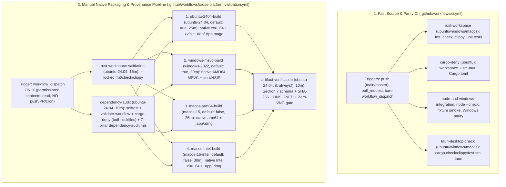

# Cross-Platform Build, Packaging & Provenance Matrix

**Document Owner:** Release Governance & Build Matrix Architecture  
**Applies To:** `desktop-instance-manager` (`Multi-Zalo Desktop` v`0.1.0`, `com.multizalodesktop.manager`)  
**Base `main` Commit:** `a5feb4a520798064c1508c26fe4c4ac17a3a03cf` (`a5feb4a`) | **Branch:** `build/cross-platform-distribution`  
**Workflows Covered:** [`.github/workflows/ci.yml`](../../../.github/workflows/ci.yml) and [`.github/workflows/cross-platform-validation.yml`](../../../.github/workflows/cross-platform-validation.yml)  
**Provenance Tooling:** [`scripts/ci-cross-platform/`](../../scripts/ci-cross-platform/) | **Execution Report:** [`ci-execution-and-artifact-validation.md`](./ci-execution-and-artifact-validation.md)

> [!IMPORTANT]
> **Four Honesty Invariants Across Every Row of This Matrix:**
> 1. **Native Runners Only (Zero Cross-Compile Masquerading):** Every OS CI job enforces native CPU/OS checks (`uname -m` / `PROCESSOR_ARCHITECTURE` + `rustc -vV` `host:`). Cross-compiling is **never** treated as native runtime verification; if `macos-15-intel` is unavailable on the account plan/pool, it reports **`BLOCKED`**.
> 2. **Compiled Executables != Installers:** `dim-desktop.exe`, `dim-cli.exe`, `dim-test-fixture.exe`, and `dim-desktop` have `artifact_kind: "compiled-executable"` and `is_installer: false` — **never** OS installers.
> 3. **Unsigned & Self-Reported != Production Release:** Local and CI validation outputs carry `signing_status: "UNSIGNED_DEVELOPMENT_ARTIFACT"` and `provenance_trust_level: "SELF_REPORTED_UNATTESTED"` (SBOM is a declared dependency inventory, **not** independent build provenance).
> 4. **DIM Manager Build != Zalo Multi-Instance Runtime Proof:** Compiling or bundling `dim-desktop` on macOS or Ubuntu 24.04 proves only that the Rust/Tauri manager shell builds and passes synthetic fixture checks — **never** that VNG Zalo macOS multi-instance isolation works (`NOT_TESTED`) or that Official Zalo exists on Linux (`UNSUPPORTED`).

---

## 1. Master Cross-Platform Native Target & Artifact Matrix (Priority Order 1 -> 4)

| Priority & Target OS | Verified GitHub Runner (`cross-platform-validation.yml`) | Native CPU Arch (`uname -m`) | Native Rust Host & Target Triple | Effective Rust MSRV | Locked Tauri & Pinned CLI | Compiled Executables (`is_installer: false`) | OS Installer / Bundle Formats (`tauri-ci-bundle-overlay.json`) | Current Signing & Provenance State | DIM Manager Build & Fixture Verification Level | Zalo Multi-Instance Runtime Verification Level |
| :--- | :--- | :---: | :--- | :---: | :--- | :--- | :--- | :--- | :--- | :--- |
| **1. Ubuntu 24.04 LTS (Noble Numbat)** | `ubuntu-24.04` (`ubuntu-2404-build`, default `true`, `25m` cap) | `x86_64` | `x86_64-unknown-linux-gnu` | **`1.90`** *(workspace `1.85` — `IR-001`)* | `tauri 2.12.6`, `@tauri-apps/cli@2.12.5` | `dim-desktop`, `dim-cli`, `dim-test-fixture` (ELF 64-bit PIE `0755`, `GLIBC >= 2.38/2.39`) | Debian `.deb` (`debian-package`), AppImage `.AppImage` (`linux-appimage`, Type 2 `AI\x02`) | `UNSIGNED_DEVELOPMENT_ARTIFACT` / `SELF_REPORTED_UNATTESTED` *(Gate G5 blocked)* | **CI-Configured** (`3` unit tests pass locally; `xvfb-run -a` + `fixture-app.mjs` + `dim-cli` configured; Remote CI **`BLOCKED` / `NOT_EXECUTED`**) | **Official VNG Zalo: `UNSUPPORTED`** (no VNG Linux build); Fixture / User AppImage: **`EXPERIMENTAL` (`NOT_TESTED` on Linux host)** |
| **2. Windows 10 / 11 & Server 2022 (64-bit)** | `windows-2022` (`windows-msvc-build`, default `true`, `30m` cap) | `AMD64` (`x86_64`) | `x86_64-pc-windows-msvc` *(CI)* / `x86_64-pc-windows-gnu` *(local UCRT64 host)* | **`1.90`** *(workspace `1.85` — `IR-001`)* | `tauri 2.12.6`, `@tauri-apps/cli@2.12.5` | `dim-desktop.exe`, `dim-cli.exe`, `dim-test-fixture.exe` *(+ `WebView2Loader.dll` sidecar)* | Windows Installer `.msi` (`installer-msi`), NSIS `*-setup.exe` (`installer-nsis`) | `UNSIGNED_DEVELOPMENT_ARTIFACT` / `SELF_REPORTED_UNATTESTED` *(Gate G3 blocked)* | **Locally Verified on Native x64 (`x86_64-pc-windows-gnu`)** (`29/29` `--locked` tests + native `fixture-app.mjs`/`dim-cli.exe` PASS; local MSI/NSIS `SKIPPED_MISSING_TOOLING`); Remote `windows-2022` CI **`BLOCKED` / `NOT_EXECUTED`** | **L1/L2 Verified Locally** (`3` concurrent official Zalo `26.10.20` instances + protected primary); L3 QR chat `NOT_TESTED`; L4 calls/toasts `BLOCKED` |
| **3. macOS 15 (Apple Silicon)** | `macos-15` (`macos-arm64-build`, opt-in `false`, `25m` cap) | `arm64` | `aarch64-apple-darwin` (`arm64` M1) | **`1.90`** *(workspace `1.85` — `IR-001`)* | `tauri 2.12.6`, `@tauri-apps/cli@2.12.5` | `dim-desktop`, `dim-cli`, `dim-test-fixture` (Mach-O 64-bit `arm64`) | `Multi-Zalo Desktop.app` (`macos-app-bundle`), `*.dmg` (`macos-dmg-installer`, valid `icon.icns` via CI overlay) | `UNSIGNED_DEVELOPMENT_ARTIFACT` / `NOT_NOTARIZED` *(Gate G4 blocked; Gatekeeper quarantines)* | **CI-Configured** (`3` unit tests pass locally; native `arm64` fixture + `.icns` overlay configured; Remote CI **`BLOCKED` / `NOT_EXECUTED`**) | **`NOT_TESTED`** (`open -n --env CFFIXED_USER_HOME` unverified on physical Mac hardware; `/tmp/socketzalorecv2021` call conflict `BLOCKED`) |
| **4. macOS 15 (Intel Mac)** | `macos-15-intel` (`macos-intel-build`, opt-in `false`, `30m` cap) | `x86_64` | `x86_64-apple-darwin` (native 4-core Intel x64) | **`1.90`** *(workspace `1.85` — `IR-001`)* | `tauri 2.12.6`, `@tauri-apps/cli@2.12.5` | `dim-desktop`, `dim-cli`, `dim-test-fixture` (Mach-O 64-bit `x86_64` verified via `lipo -archs`) | `Multi-Zalo Desktop.app` (`macos-app-bundle`), `*.dmg` (`macos-dmg-installer`, valid `icon.icns` via CI overlay) | `UNSIGNED_DEVELOPMENT_ARTIFACT` / `NOT_NOTARIZED` *(Gate G4 blocked; Gatekeeper quarantines)* | **CI-Configured on Native `macos-15-intel`** (`macos-13` retired; fails closed as **`BLOCKED`** if Intel pool unavailable; Remote CI **`BLOCKED` / `NOT_EXECUTED`**) | **`NOT_TESTED`** (unverified on physical Intel Mac hardware; `/tmp/socketzalorecv2021` call conflict `BLOCKED`) |

### Toolchain & Runner Architecture Notes
- **Canonical `x86_64-pc-windows-msvc` vs. Local `x86_64-pc-windows-gnu`:** [`deny.toml`](../../deny.toml) audits both Windows triples. `windows-2022` builds canonical `x86_64-pc-windows-msvc` (clean `rc.exe`/`mt.exe` manifest embedding, `GUARD_CF` support, preinstalled WiX 3.14 & NSIS 3.x), whereas local developer validation on Windows 11 Pro (`10.0.26300` x64) executed natively on `x86_64-pc-windows-gnu` (WinLibs UCRT64 `gcc 16.2.0`) because VS C++ Build Tools are not installed locally.
- **Explicit Native `macos-15` (`arm64`) vs. `macos-15-intel` (`x86_64`):** Per GitHub's current runner catalog, `macos-13` is retired, `macos-15` is 3-core Apple Silicon (`arm64`), and `macos-15-intel` is 4-core Intel (`x86_64`, scheduled to sunset in Fall 2027). Both jobs assert `uname -m` and `rustc -vV` at startup; `macos-intel-build` **never** cross-compiles on an `arm64` host.
- **Non-Destructive CI Bundle Overlay (`tauri-ci-bundle-overlay.json`):** [`scripts/ci-cross-platform/tauri-ci-bundle-overlay.json`](../../scripts/ci-cross-platform/tauri-ci-bundle-overlay.json) injects valid generated `assets/icon.icns` (`1,142` B) and `assets/128x128@2x.png` (`716` B), Windows `downloadBootstrapper`, macOS `minimumSystemVersion: "11.0"`, and Ubuntu 24.04 `deb.depends` via `tauri build --config` without mutating shared `tauri.conf.json` (permanent upstream patches reside in [`plans/reports/build/ir-patches/`](../../plans/reports/build/ir-patches/)).

---

## 2. Toolchain, MSRV, Dual-Lockfile & Advisory Baseline

| Parameter | Verified / Locked Value | Authoritative Source | Governance Note |
| :--- | :--- | :--- | :--- |
| **Core Workspace MSRV** | `rust-version = "1.85"` | [`desktop-instance-manager/Cargo.toml`](../../Cargo.toml) | Patched to `"1.90"` in [`0001-IR-001-align-workspace-msrv-1.90.patch`](../../plans/reports/build/ir-patches/0001-IR-001-align-workspace-msrv-1.90.patch). |
| **Effective Packaging MSRV** | **`rust-version = "1.90"`** | [`apps/desktop/src-tauri/Cargo.toml`](../../apps/desktop/src-tauri/Cargo.toml) | Required by `tauri 2.12.6`, `sha2 0.11.1`, `wry 0.57.2`. |
| **Pinned Tauri Bundler CLI** | **`@tauri-apps/cli@2.12.5`** | `.github/workflows/cross-platform-validation.yml` & `build-and-package.mjs` | Exact version verified via `npm view @tauri-apps/cli version` (never floating `@latest`; `IR-004`). |
| **Core & Tauri Lockfiles** | `41` pkgs (`deeb58a0...`) + `434` pkgs (`0bcb1b65...`) = **`439` unique** | [`dependency-audit-report.json`](../../plans/reports/build/dependency-audit-report.json) | `431/431` `crates.io` SHA-256 checksums verified; `--locked` enforced across all Cargo stages. |
| **Real RustSec Advisory Scan** | **`0` vulnerabilities, `0` yanked (`cargo-deny 0.21.0`)** | [`dependency-audit-summary.md`](../../plans/reports/build/dependency-audit-summary.md) | Scanned against live `rustsec/advisory-db` @ `233155b4025b854c68a4b199c0e32d7fd53291a2` on both lockfiles. |
| **Node.js Automation Runtime** | Node.js `>= 22` ESM (`node:*` built-ins only) | [`scripts/ci-cross-platform/*.mjs`](../../scripts/ci-cross-platform/) | Zero external runtime `npm` packages (`16/16` `selftest.mjs` PASS, `6/6` `validate-workflow.mjs` PASS). |

---

## 3. Workflow Architecture & Separation of Duties (`ci.yml` vs. `cross-platform-validation.yml`)

| Attribute | [`.github/workflows/ci.yml`](../../../.github/workflows/ci.yml) | [`.github/workflows/cross-platform-validation.yml`](../../../.github/workflows/cross-platform-validation.yml) |
| :--- | :--- | :--- |
| **Role** | Continuous code-quality, lint, unit-test, and Windows contract-parity gate | Manual native 7-stage release build, runtime fixture, OS bundler packaging (via overlay), and Section 7 provenance pipeline |
| **Triggers** | `push` (`main`, `master`), `pull_request` (`main`, `master`), `workflow_dispatch` | **`workflow_dispatch` ONLY** (`enable_ubuntu`, `enable_windows`, `enable_macos_arm64`, `enable_macos_intel`, `bundles`; requires registration on default branch `main`) |
| **Permissions & Releases** | Repository default; zero releases | Explicit **`permissions: contents: read`**; zero secrets, zero GitHub Releases (Gate G6) |
| **Supply-Chain & Advisory Gate** | `EmbarkStudios/cargo-deny-action@v2` | `EmbarkStudios/cargo-deny-action@v2` (`advisories bans licenses sources --locked` on both lockfiles) + 7-pillar `dependency-audit.mjs` |

---

## 4. Grounded Private-Repository GitHub Actions Cost & Quota Governance

Verified via `gh api repos/manhquydev/zalo` (`private: true`, `owner_type: User`) and current GitHub Actions pricing (`docs.github.com/.../about-billing-for-github-actions`, per-job minute rounding; Free tier includes `2,000` Linux-eq min / `$12.00` monthly credit, Pro includes `3,000` min / `$18.00` credit):

| Job ID | Runner Label | Billing SKU & Verified Rate | Classic Multiplier | Est. Rounded Min | Est. USD / Run | Multiplier Min | Default Input |
| :--- | :--- | :--- | :---: | :---: | :---: | :---: | :--- |
| `rust-workspace-validation` | `ubuntu-24.04` | `actions_linux` (`$0.006/min`) | **1x** | `6m` | `$0.036` | `6m` | Always |
| `dependency-audit` | `ubuntu-24.04` | `actions_linux` (`$0.006/min`) | **1x** | `3m` | `$0.018` | `3m` | Always |
| `ubuntu-2404-build` | `ubuntu-24.04` | `actions_linux` (`$0.006/min`) | **1x** | `10m` | `$0.060` | `10m` | `enable_ubuntu: true` |
| `windows-msvc-build` | `windows-2022` | `actions_windows` (`$0.010/min`) | **2x** (`~1.67x` $) | `12m` | `$0.120` | `24m` | `enable_windows: true` |
| `macos-arm64-build` | `macos-15` | `actions_macos` (`$0.062/min`) | **10x** (`~10.33x` $) | `14m` | **`$0.868`** | **`140m`** | **`enable_macos_arm64: false`** |
| `macos-intel-build` | `macos-15-intel` | `actions_macos` (`$0.062/min`) | **10x** (`~10.33x` $) | `15m` | **`$0.930`** | **`150m`** | **`enable_macos_intel: false`** |
| `artifact-verification` | `ubuntu-24.04` | `actions_linux` (`$0.006/min`) | **1x** | `2m` | `$0.012` | `2m` | Always (`if: always()`) |
| **Default Dispatch (Ubuntu + Win)** | — | — | — | **`33m`** | **`$0.246`** | **`45m`** (`2.25%` of 2,000) | Safe routine validation |
| **Full 4-OS Dispatch (+ 2x macOS)** | — | — | — | **`62m`** | **`$2.044`** | **`335m`** (`16.75%` of 2,000) | Explicit opt-in (**88.0% saved** when off) |

**Mandatory Cost Controls:** (1) `schedule` crons are strictly banned; (2) both `$0.062/min` (`10x`) macOS jobs default to `false`; (3) every job declares bounded `timeout-minutes` (`10–30m`); (4) all artifact uploads set `retention-days: 7`.

---

## 5. Traceable Section 7 Artifact Manifest Schema v2 Reference

Generated by [`scripts/ci-cross-platform/generate-artifact-manifest.mjs`](../../scripts/ci-cross-platform/generate-artifact-manifest.mjs) (`schema_version: 2`) paired with [`inspect-artifact.mjs`](../../scripts/ci-cross-platform/inspect-artifact.mjs).

### 5.1 Top-Level Manifest Envelope (`schema_version: 2`)
Includes `schema_version` (`2`), `manifest_kind` (`"cross-platform-artifact-manifest"`), `generated_at_utc`, `os_label`, `target_triple`, `build_commit_sha`, `rust_version`, `tauri_version` (`"2.12.6"`), `provenance_trust_level` (`"SELF_REPORTED_UNATTESTED"` locally; distinct from CI OIDC SLSA attestation), `supply_chain_separation` (`sbom_vs_provenance: "SBOM_IS_DECLARED_INVENTORY_NOT_INDEPENDENT_BUILD_PROVENANCE"`, `oidc_slsa_attestation_present`, `signing_status`, `raw_executables_are_installers`), `test_status`, `runtime_fixture_status`, `bundle_status`, `bundle_diagnostic_reason`, `signing_policy`, `zero_vng_binary_policy_passed` (`true`), `artifacts_count`, and `artifacts[]`.

### 5.2 Per-Artifact Record Schema (`SECTION_7_REQUIRED_FIELDS` — 19 Required Fields)

| Field Name | Core Section 7? | Validation Rule |
| :--- | :---: | :--- |
| `name` | **Yes (1/11)** | Artifact basename; aborts fatally if matching `Zalo.exe`, `Zalo.app`, `ZaloSetup*`, or `app.asar` |
| `os` | **Yes (2/11)** | Canonical OS from binary/package header (`"windows"`, `"macos"`, `"linux"`) |
| `cpu_architecture` | **Yes (3/11)** | Inspected CPU arch (`"x86_64"`, `"aarch64"`, `"universal"`) |
| `build_commit_sha` | **Yes (4/11)** | Full 40-hex Git commit SHA |
| `rust_version` | **Yes (5/11)** | Exact `rustc --version` string |
| `tauri_version` | **Yes (6/11)** | Locked `tauri` crate version (`"2.12.6"`) |
| `file_size_bytes` | **Yes (7/11)** | Exact byte size on disk (`> 0`) |
| `sha256` | **Yes (8/11)** | Lowercase 64-hex SHA-256 digest matching `SHA256SUMS.txt` |
| `signing_status` | **Yes (9/11)** | Strictly `"UNSIGNED_DEVELOPMENT_ARTIFACT"` when unsigned (never `"signed"` or `"production"`) |
| `test_status` | **Yes (10/11)** | Native test execution status (e.g., `"PASSED_NATIVE"`) |
| `build_log_url` | **Yes (11/11)** | GitHub Actions run URL or `"LOCAL_WORKTREE_BUILD:..."` |
| `provenance_trust_level` | Extended (12/19) | `"SELF_REPORTED_UNATTESTED"` vs verified CI OIDC SLSA attestation |
| `artifact_kind` | Extended (13/19) | `"compiled-executable"`, `"installer-msi"`, `"installer-nsis"`, `"macos-app-bundle"`, `"macos-dmg-installer"`, `"debian-package"`, `"linux-appimage"` |
| `is_installer` | Extended (14/19) | **Must be `false`** on `"compiled-executable"`; `true` only on OS installer packages |
| `rust_target_triple` | Extended (15/19) | `x86_64-unknown-linux-gnu`, `x86_64-pc-windows-msvc`, `x86_64-pc-windows-gnu`, `aarch64-apple-darwin`, `x86_64-apple-darwin` |
| `notarization_status` | Extended (16/19) | `"NOT_NOTARIZED (...)"` on macOS; `"NOT_APPLICABLE (...)"` on Windows/Linux |
| `zalo_runtime_compat_status` | Extended (17/19) | Explicit honesty string separating DIM manager build from Zalo runtime compatibility |
| `vng_binary_embedded` | Extended (18/19) | **Must be `false`** (Gate G1 Zero-VNG policy assertion) |
| `inspection` | Extended (19/19) | Header forensics from `inspect-artifact.mjs` (PE32+/Authenticode/XML manifest/WebView2; Mach-O/`Info.plist`/`.icns`; ELF/`ldd`/`GLIBC`/`.deb`/`.AppImage`) |

---

## 6. Related Packaging & Governance Documents

- [`ci-execution-and-artifact-validation.md`](./ci-execution-and-artifact-validation.md) | [`signing-and-release-gates.md`](./signing-and-release-gates.md) | [`release-readiness.md`](./release-readiness.md)
- [`windows.md`](./windows.md) | [`macos.md`](./macos.md) | [`ubuntu.md`](./ubuntu.md)
- [`../../plans/reports/build/ci-baseline-and-github-audit.md`](../../plans/reports/build/ci-baseline-and-github-audit.md) | [`../../plans/reports/build/integration-requests.md`](../../plans/reports/build/integration-requests.md)
