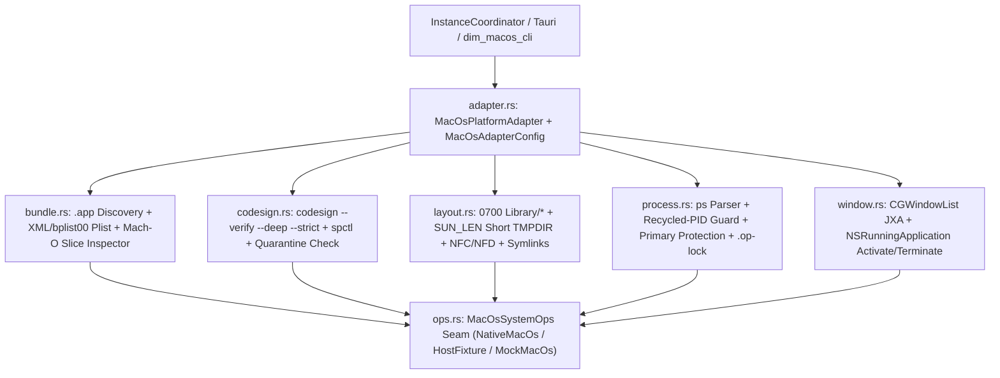

# macOS Native Multi-Zalo Implementation Report (`dim-platform-macos`)

**Branch:** `feat/macos-multi-instance`  
**Base Commit:** `a5feb4a520798064c1508c26fe4c4ac17a3a03cf`  
**Target Crate:** [`desktop-instance-manager/crates/platform-macos`](../../../crates/platform-macos/src/lib.rs)  
**Live Official `Zalo.app` Status:** **`LIVE_ZALO_NOT_TESTED`** (`SupportStatus::NotTested` — developed, cross-target compiled, clippy-verified for `aarch64-apple-darwin` & `x86_64-apple-darwin`, and fixture-tested on a Windows host without physical Apple hardware attached)

---

## 1. Architecture & Module Summary

### Implemented Modules (`crates/platform-macos/`)

| File | Responsibility |
| :--- | :--- |
| [`src/ops.rs`](../../../crates/platform-macos/src/ops.rs) | Injectable `MacOsSystemOps` trait with `NativeMacOsSystemOps` (Darwin `libc::geteuid`, `getpwuid_r`, `statvfs`, `kill`, `0o700` `DirBuilderExt`, `open`/`codesign`/`spctl`/`plutil`/`mdfind`/`ps`/`osascript`), `UnsupportedHostSystemOps`, `HostFixtureMacOsOps` (cross-platform live process harness with `bInheritHandles = FALSE` on Windows), and deterministic `MockMacOsSystemOps`. |
| [`src/bundle.rs`](../../../crates/platform-macos/src/bundle.rs) | Discovers `/Applications/Zalo.app`, `~/Applications/Zalo.app`, Spotlight `mdfind` fallback, or `custom_root`; enforces `MACOS_PATH_MAX` (`1024`) and traversal guards; parses XML `Info.plist` and binary `bplist00` (via `/usr/bin/plutil -convert xml1 -o -` + pure-Rust fallback); inspects thin Mach-O (`MH_MAGIC_64`) and Universal2 (`FAT_MAGIC`, `FAT_MAGIC_64`) slices (`arm64` vs `x86_64`) and `ZaloHelper.app`/`ZaloCall`. |
| [`src/codesign.rs`](../../../crates/platform-macos/src/codesign.rs) | Verifies sealed bundles via `/usr/bin/codesign --verify --deep --strict --verbose=2`, extracts `Identifier`, `TeamIdentifier`, `Authority` chain, and `Signature=adhoc` via `codesign -dv --verbose=4`, assesses Gatekeeper via `/usr/sbin/spctl --assess --type execute --verbose=4`, reads `com.apple.quarantine` xattr non-destructively, and enforces `DimError::UnverifiedBinary` (`UNVERIFIED_BINARY`). |
| [`src/layout.rs`](../../../crates/platform-macos/src/layout.rs) | Creates `0o700` isolated `Library/Application Support/{ZaloData,Zalo}`, `Preferences`, `Caches`, `Saved Application State`, `Logs`, `HTTPStorages`, `WebKit`, `tmp`, `.zalo-profile-id`, `zmeta.json`, `migrate-config.json`, and `.macos-profile-meta.json`. Solves macOS `SUN_LEN` (`104`-byte `sockaddr_un.sun_path`) via `resolve_effective_tmpdir` (`/tmp/dim-zalo-<uid>-<id>` when `<profile_dir>/tmp` exceeds `54` bytes, verified non-symlink, `0o700`, `uid == geteuid()`). Implements pure-Rust NFD/NFC canonical decomposition for Vietnamese, Latin, and Hangul paths, plus safe user/Keychain symlinks blocking `Application Support`/`Preferences` symlinks. |
| [`src/process.rs`](../../../crates/platform-macos/src/process.rs) | Parses `/bin/ps -axo pid=,ppid=,uid=,stat=,rss=,comm=,args=` (preserving spaces in `.app` paths and discarding `Z` zombies); verifies candidate PIDs against `uid`, primary PID set, and profile/bundle command lines so recycled foreign PIDs (`Safari`, `launchd`, other profiles) are never misattributed or killed; fixes dangling `SingletonLock` symlink detection via `fs::symlink_metadata` (`lstat`); implements `ProfileOperationGuard` (`Mutex<HashSet<String>>` + `<profile_dir>/tmp/.op-lock`), SQLite `-wal`-aware graceful shutdown (`NSRunningApplication.terminate()` -> bounded isolated `SIGTERM`), and `recover_macos_stale_artifacts`. |
| [`src/window.rs`](../../../crates/platform-macos/src/window.rs) | Queries window handles/titles via `.window-state.json` and parameterized JXA `CGWindowListCopyWindowInfo` (no TCC Screen Recording prompts); activates windows via parameterized AppleScript `NSRunningApplication.activateWithOptions` (zero TCC Accessibility required) with best-effort `System Events` frontmost raise. |
| [`src/adapter.rs`](../../../crates/platform-macos/src/adapter.rs) & [`src/lib.rs`](../../../crates/platform-macos/src/lib.rs) | Full backwards-compatible `MacOsPlatformAdapter` implementing `ApplicationLocator`, `PlatformCapabilities` (`is_elevated`, `check_profiles_acl_safe`, `free_disk_bytes`, `unlink_profile_junctions`), `InstanceMonitor`, `InstanceLauncher`, and `RecoveryManager`. |
| [`examples/dim_macos_cli.rs`](../../../crates/platform-macos/examples/dim_macos_cli.rs) & [`tests/platform-macos/`](../../../tests/platform-macos/run-macos-fixture-tests.mjs) | Zero-extra-dependency JSON CLI harness, macOS-realistic Node fixture (`fixture-macos-app.mjs`), 9 Rust integration tests (`tests/macos_scenarios.rs`), and 13-scenario E2E runner (`run-macos-fixture-tests.mjs`). |

---

## 2. Capability & Scenario Verification Matrix (`PASS` / `FAIL` / `NOT_TESTED` / `BLOCKED`)

### 2.1. Subsystem Capabilities

| Capability | Fixture / Mock / Compiler Status | Live Official `Zalo.app` Status | Evidence |
| :--- | :---: | :---: | :--- |
| `.app` Bundle, XML & `bplist00` Plist, Spotlight `mdfind` | **`PASS`** | **`NOT_TESTED`** | `macos_scenarios::bundle_discovery_bplist00_plutil_spotlight_and_arch_compatibility` |
| Pure-Rust Mach-O (`MH_MAGIC_64`, `FAT_MAGIC`, `arm64`/`x86_64`) | **`PASS`** | **`NOT_TESTED`** | `macos_scenarios::macho_inspector_parses_arm64_x86_64_universal2_and_fat64` |
| `codesign` + `spctl` + Quarantine Trust Enforcement | **`PASS`** | **`NOT_TESTED`** | `macos_scenarios::codesign_enforces_unverified_binary_on_unsigned_adhoc_tampered_and_wrong_publisher` |
| `aarch64-apple-darwin` & `x86_64-apple-darwin` Compilation & Clippy | **`PASS`** | N/A | `cargo check` & `cargo clippy --no-deps -- -D warnings` exit `0` on both targets |
| Concurrent Voice/Video Calls (`ZaloCall` `/tmp/socketzalorecv2021`) | **`BLOCKED`** | **`BLOCKED`** | Hardcoded `/tmp/socketzalorecv2021` `fs.unlink` conflict in `app.asar/main.js:314800` |
| Live Official VNG `/Applications/Zalo.app` GUI Execution | N/A | **`LIVE_ZALO_NOT_TESTED`** | No physical Mac attached to this Windows build environment |

### 2.2. Required 13 Multi-Instance & Safety Scenarios

| # | Scenario | Status | Automated Verification Evidence |
| :---: | :--- | :---: | :--- |
| **1** | **1 Session Launch, Window Detection & Focus** | **`PASS`** | `run-macos-fixture-tests.mjs` Scenario 1 + `macos_scenarios` (`running=true`, `focus_count >= 1`) |
| **2** | **2 Concurrent Isolated Sessions** | **`PASS`** | `run-macos-fixture-tests.mjs` Scenario 2 (`2` distinct live PIDs & window titles) |
| **3** | **3 Concurrent Isolated Sessions** | **`PASS`** | `run-macos-fixture-tests.mjs` Scenario 3 (`3` distinct live PIDs, `3` distinct `zalo_user_id`s, RSS & disk size `> 0`) |
| **4** | **Isolated Data (`ZaloData`, `Preferences`, `Caches`) & Dup-UID Guard** | **`PASS`** | `run-macos-fixture-tests.mjs` Scenario 4 (`DUPLICATE_ZALO_USER_ID` blocked; zero cross-profile plist/cache bleed) |
| **5** | **Relaunch, Idempotent Running Launch & Offline Backup/Restore** | **`PASS`** | `run-macos-fixture-tests.mjs` Scenario 5 (same PID on repeat launch; `launch_count=2` on relaunch; SHA-256 restore to new profile) |
| **6** | **Individual Close Preserving Sibling Sessions** | **`PASS`** | `run-macos-fixture-tests.mjs` Scenario 6 (stopping Profile 2 leaves Profiles 1 & 3 running on original PIDs) |
| **7** | **Duplicate Concurrent Operation Guard** | **`PASS`** | `run-macos-fixture-tests.mjs` Scenario 7 (cross-process `.op-lock`) + `macos_scenarios::scenario_7` (in-process `Barrier` race -> `PROCESS_ERROR`) |
| **8** | **Crash Recovery (`SingletonLock`, `SingletonSocket`, `SingletonCookie`, `lockfile`)** | **`PASS`** | `run-macos-fixture-tests.mjs` Scenario 8 (`--crash` -> `stale_lock_detected=true` -> `crash_recovered=true`) |
| **9** | **Process Ownership (Recycled Foreign PID) & Primary Protection** | **`PASS`** | `run-macos-fixture-tests.mjs` Scenario 9 + `macos_scenarios::scenario_8_and_9` (recycled Safari PID untouched; primary PID -> `PROTECTED_PRIMARY_PROCESS`; primary path -> `PROTECTED_PRIMARY_PATH`) |
| **10** | **Safe Symlink Unlinking Before Profile Deletion** | **`PASS`** | `run-macos-fixture-tests.mjs` Scenario 10 (`CONFIRM_REQUIRED` enforced; `unlinked_symlinks=1`; external host file preserved) |
| **11** | **Unicode Filenames (NFC/NFD Vietnamese, CJK, Hangul)** | **`PASS`** | `run-macos-fixture-tests.mjs` Scenario 11 + `macos_scenarios::scenario_11_12_13` (NFD primary guard -> `PROTECTED_PRIMARY_PATH`; CJK/VN launch/stop clean) |
| **12** | **Long Paths (`SUN_LEN` 104B Short `TMPDIR` & `PATH_MAX` 1024B)** | **`PASS`** | `run-macos-fixture-tests.mjs` Scenario 12 (`short_tmpdir_fallback=true`, `socket_path_bytes=72 <= 103`, `>=1024B` -> `PATH_TRAVERSAL`) |
| **13** | **Permission Failures (`0700`, `0777` Detection, `0500` Read-Only)** | **`PASS`** | `run-macos-fixture-tests.mjs` Scenario 13 (`acl_safe: true -> false` on `0777`; `IO_ERROR` on `0500` read-only parent) |

---

## 3. Physical Mac Live-Zalo Verification Checklist (Exit Gate from `LIVE_ZALO_NOT_TESTED`)

Before changing `official_zalo_status` from `SupportStatus::NotTested` to `SupportStatus::PartiallySupported`, execute on physical Apple Silicon (`arm64`) and Intel (`x86_64`) macOS 14/15+ hosts with official VNG `/Applications/Zalo.app`:

1. Run `cargo test --workspace --all-targets --locked` and `node tests/platform-macos/run-macos-fixture-tests.mjs` natively on macOS.
2. Verify `discover_installation(None)` parses official `/Applications/Zalo.app` (`bplist00` `Info.plist`, Mach-O slices, `codesign --verify --deep --strict`, `spctl --assess` `Notarized Developer ID`).
3. Keep primary Zalo logged in at `~/Library/Application Support/ZaloData`, launch 2 isolated secondary profiles, and confirm via `lsof -p <pid>` that zero SQLite/cookie handles inside secondary instances point into primary `~/Library/Application Support/ZaloData`.
4. Measure Keychain `"Zalo Safe Storage"` prompt behavior across 2+ logged-in accounts and verify QR-login-screen quit latency (`NSRunningApplication.terminate()` -> `SIGTERM` fallback).
5. Confirm primary Zalo remains untouched when stopping or deleting secondary profiles.

---

## 4. Operations & Rollback Guide

- **Safe Profile Storage Location:** `~/Library/Application Support/MultiZaloDesktop/Profiles/<slug>_<8hex>` (override via `DIM_DATA_DIR`). Primary `~/Library/Application Support/ZaloData` is never modified.
- **Short Socket Temp Cleanup:** When long profile paths trigger `SUN_LEN` fallback, empty `/tmp/dim-zalo-<uid>-<id>` directories (`0o700`) can be safely removed once all isolated profiles are stopped.
- **Branch / Adapter Rollback:** All changes on `feat/macos-multi-instance` are strictly confined to `crates/platform-macos/**`, `tests/platform-macos/**`, `docs/platform/macos/**`, and `plans/reports/macos/**` with zero `Cargo.lock` or shared-crate schema changes. Rolling back or disabling macOS support leaves Windows, Linux, `profiles.json`, and backup manifests 100% unaffected.
