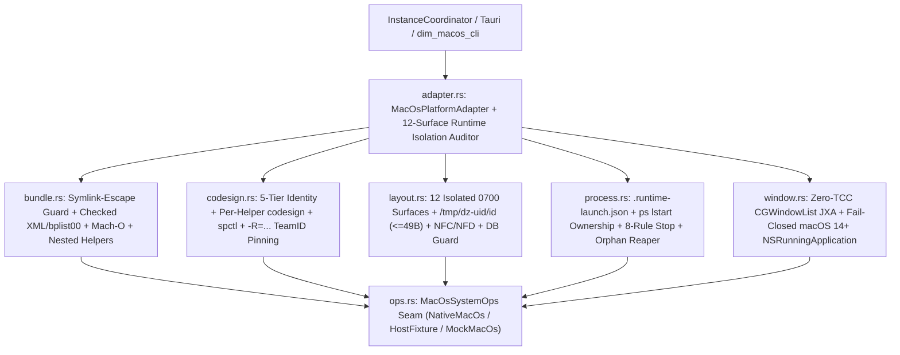

# macOS Native Multi-Zalo Implementation Report (`dim-platform-macos` — Stage 2 Hardened)

**Branch:** `feat/macos-multi-instance`  
**Baseline Commit (`main`):** `a5feb4a520798064c1508c26fe4c4ac17a3a03cf`  
**Stage 1 Commit:** `fb2abcfc419c56b9579eee124a3a169697ec2740`  
**Stage 2 Commit:** `862822433a833f277004ffb5511c5bdbe28c6b09`  
**Target Crate:** [`desktop-instance-manager/crates/platform-macos`](../../../crates/platform-macos/src/lib.rs)  
**Verification Classification (6-State Taxonomy):**
- **Compiler & Darwin Cross-Targets (`aarch64-apple-darwin`, `x86_64-apple-darwin`):** **`STATIC_VERIFIED`**
- **Host Mock & Live Detached Process Harness (`40` Rust tests + `15` CLI E2E scenarios + C2 `xf-test-runner` scratch overlay):** **`WINDOWS_HOST_FIXTURE_TESTED`**
- **Native Darwin Kernel Execution (`macos-15` / `macos-15-intel`):** **`NOT_TESTED`** (**`BLOCKED`** locally — no physical Mac attached; remote GitHub Actions gated by default-branch workflow registration, `gh auth refresh -h github.com -s workflow`, & `$0.062/min` 10x macOS billing policy)
- **Live Official VNG `/Applications/Zalo.app` Execution:** **`NOT_TESTED`** (`LIVE_ZALO_NOT_TESTED` / `SupportStatus::NotTested`)

---

## 1. Architecture & Stage-2 Hardened Modules

### Module Inventory (`crates/platform-macos/`)

| File | Stage-2 Hardened Responsibility |
| :--- | :--- |
| [`src/ops.rs`](../../../crates/platform-macos/src/ops.rs) | Injectable `MacOsSystemOps` seam with `ProcessEntry.start_token` (`ps -o lstart=` on Darwin, Win32 `GetProcessTimes` `FILETIME` on Windows host), `NativeMacOsSystemOps` (`geteuid`, `getpwuid_r`, `statvfs`, `kill`, non-recursive `0o700` `DirBuilderExt`), `UnsupportedHostSystemOps`, `HostFixtureMacOsOps` (PID-reuse eviction, `bInheritHandles = FALSE` detached spawn, catchable `SIGTERM` simulation), and `MockMacOsSystemOps` (`MockSigtermHandler`). |
| [`src/bundle.rs`](../../../crates/platform-macos/src/bundle.rs) | Defines `AppIdentityVerificationTier` (`BundlePresent`..`VerifiedPublisherIdentity`); rejects symlinks escaping bundle boundaries (`ensure_bundle_no_symlink_escape`); validates balanced XML `Info.plist` and fails closed when `plutil` rejects `bplist00`; enumerates nested helpers (`Contents/Frameworks/*.app`, `ZaloHelper.app`, `ZaloCall`); inspects thin Mach-O & Universal2 (`FAT_MAGIC`, `FAT_MAGIC_64`) CPU slices (`arm64` vs `x86_64`). |
| [`src/codesign.rs`](../../../crates/platform-macos/src/codesign.rs) | Enforces 5-tier cryptographic trust: root `codesign --verify --deep --strict`, individual `codesign --verify` on every nested helper bundle, `codesign -dv --verbose=4`, Gatekeeper `spctl --assess --type execute`, read-only `com.apple.quarantine` check, and explicit `PinnedPublisherPolicy` (`codesign --verify --deep --strict -R=...` with pinned `CFBundleIdentifier` + `TeamIdentifier`). Default policy is `None` — publisher trust is **never** guessed from `"Zalo.app"` or `"VNG"` substrings. |
| [`src/layout.rs`](../../../crates/platform-macos/src/layout.rs) | Defaults `MacOsLayoutOptions` to `{ symlink_user_dirs: false, symlink_keychain: false }` so all 12 surfaces (`MACOS_12_ISOLATED_SURFACES`, including `Downloads`, `Documents/Zalo Received Files`, and `Library/Keychains`) are isolated `0o700` directories by default (`CT-03` compatible). Hardens Darwin `SUN_LEN` (`104B`) fallback to two-level `/tmp/dz-<uid>/<id>` (`<= 49` bytes, atomic non-recursive `0o700`, `lstat` UID/symlink check) + `cleanup_profile_short_tmpdir` (never touching `/tmp/socketzalo*2021`). Guards `config.json -> db_path.location` (`F-CORE-01`), fixes concurrent `.macos-profile-meta.*.tmp` atomic writes (`DEFECT-04`), passes `MAC_CHROMIUM_TMPDIR` + `--disk-cache-dir`, and derives deterministic per-profile fixture `user_id`s (`DEFECT-02`). |
| [`src/process.rs`](../../../crates/platform-macos/src/process.rs) | Persists `.runtime-launch.json` (`RuntimeLaunchRecord` with `pid` + `process_start_token`) + `.runtime-pid`; parses `/bin/ps -axo pid=,ppid=,uid=,stat=,rss=,lstart=,args=`; requires multi-factor ownership (`.zalo-profile-id` + matching `lstart` + argv lineage or verified launch record) to defeat same-UID/same-binary `Zalo.app` PID reuse; protects primary & unmanaged `Zalo.app` PIDs; tracks `ppid == 1` profile-tagged orphan helpers; implements 8-rule graceful shutdown (dedicated graceful window before `SIGTERM`, fail-closed `PROCESS_ERROR` if hung). |
| [`src/window.rs`](../../../crates/platform-macos/src/window.rs) | Zero `System Events` AppleEvents (zero TCC Accessibility or Automation prompts); queries layer-0 windows via JXA `CGWindowListCopyWindowInfo`; activates via AppKit `NSRunningApplication` (`unhide()`, `activateWithOptions:3`, `isActive()` check), failing closed with `PROCESS_ERROR` when macOS 14+ cooperative focus declines activation or target PID is unowned (`P1-3`). |
| [`src/adapter.rs`](../../../crates/platform-macos/src/adapter.rs) & [`src/lib.rs`](../../../crates/platform-macos/src/lib.rs) | Full backwards-compatible `MacOsPlatformAdapter` + `verify_12_surface_runtime_isolation` runtime auditor (`XP-MAC-01`, `XP-MAC-03`, and `CT-03` verified). |
| [`examples/dim_macos_cli.rs`](../../../crates/platform-macos/examples/dim_macos_cli.rs) & [`tests/platform-macos/`](../../../tests/platform-macos/run-macos-fixture-tests.mjs) | JSON CLI harness, 12-surface macOS fixture (`fixture-macos-app.mjs` with `--delayed-exit-ms`, `--hang-on-quit`, `--orphan-helper`, `--slow-startup-pre-lock-ms`), `10` Rust integration scenario suites (`tests/macos_scenarios.rs`), and `15`-scenario E2E CLI runner (`run-macos-fixture-tests.mjs`). |

---

## 2. Capability & Scenario Verification Summary (6-State Taxonomy)

| Capability / Scenario | Current Verification State | Live `Zalo.app` State | Automated Evidence |
| :--- | :---: | :---: | :--- |
| `aarch64-apple-darwin` & `x86_64-apple-darwin` Compilation & `clippy -D warnings` | **`STATIC_VERIFIED`** | N/A | `cargo check` & `cargo clippy --no-deps -- -D warnings` exit `0` on both targets |
| 5-Tier Bundle, Mach-O, Nested Helpers & Publisher Pinning (`P0-1`, all 7 failure modes) | **`WINDOWS_HOST_FIXTURE_TESTED`** | **`NOT_TESTED`** | `macos_scenarios::p0_1_all_seven_bundle_and_codesign_identity_failure_modes_plus_tier5_verified_publisher` |
| 12-Surface Data Isolation, Default `Downloads` Isolation & `db_path.location` Guard (`P0-2`) | **`WINDOWS_HOST_FIXTURE_TESTED`** | **`NOT_TESTED`** | `macos_scenarios::p0_2_twelve_surface_data_isolation_ct03_and_external_db_path_guard` + E2E Scenario 4 |
| Multi-Evidence `lstart` PID Reuse Defense, Restart Re-Attach & Primary Guard (`P0-3`, all 8 cases) | **`WINDOWS_HOST_FIXTURE_TESTED`** | **`NOT_TESTED`** | `macos_scenarios::p0_3_all_eight_process_ownership_pid_reuse_and_primary_protection_cases` + E2E Scenario 9 |
| `XP-MAC-03`, `LC-06`, `LC-07`, `LC-08`, `LC-09` Regressions (`P0-4` `DEFECT-01..06`) | **`WINDOWS_HOST_FIXTURE_TESTED`** | **`NOT_TESTED`** | `macos_scenarios::p0_4_defects_01_to_06_xp_mac_03_static_and_runtime_contracts` + E2E Scenario 14 |
| Darwin `SUN_LEN` (`104B`) `/tmp/dz-<uid>/<id>` Anti-Squatting & Cleanup (`P1-1`) | **`WINDOWS_HOST_FIXTURE_TESTED`** | **`NOT_TESTED`** | `macos_scenarios::p1_1_sun_len_short_tmpdir_symlink_squatting_and_foreign_slot_hardening` + E2E Scenario 12 |
| 8-Rule Graceful Shutdown, Delayed Quit, Hung Fail-Closed & `ppid=1` Orphans (`P1-2`, all 7 cases) | **`WINDOWS_HOST_FIXTURE_TESTED`** | **`NOT_TESTED`** | `macos_scenarios::p1_2_all_seven_graceful_shutdown_timeout_hung_and_orphan_helper_scenarios` + E2E Scenario 15 |
| Zero-TCC macOS 14+ Cooperative Window Activation (`P1-3`, all 4 cases) | **`WINDOWS_HOST_FIXTURE_TESTED`** | **`NOT_TESTED`** | `macos_scenarios::p1_3_all_four_macos_14_window_activation_and_zero_tcc_cases` |
| Concurrent Voice/Video Calls (`ZaloCall` `/tmp/socketzalorecv2021`) | **`BLOCKED`** | **`BLOCKED`** | Hardcoded `/tmp/socketzalorecv2021` `fs.unlink` conflict in `app.asar/main.js:314800` |
| Native Darwin Kernel CI Execution (`macos-15`, `macos-15-intel`) | **`NOT_TESTED`** (`BLOCKED` locally) | **`NOT_TESTED`** | See [`integration-handoff.md`](./integration-handoff.md) (`IR-MACOS-CI-01`) |
| Physical Mac Live Official `/Applications/Zalo.app` Execution | N/A | **`NOT_TESTED`** (`LIVE_ZALO_NOT_TESTED`) | See [`live-zalo-test-checklist.md`](./live-zalo-test-checklist.md) |

---

## 3. Operations & Safe Rollback Guide

- **Isolated Profile Root:** `~/Library/Application Support/MultiZaloDesktop/Profiles/<slug>_<8hex>` (`0o700`, override via `DIM_DATA_DIR`). Primary `~/Library/Application Support/ZaloData` is never modified.
- **Short Socket Temp Slot:** Long profile paths allocate `/tmp/dz-<uid>/<profile_id>` (`0o700`, `<= 49` bytes) and clean ONLY that per-profile directory upon `stop()` or `recover_stale_state()`, never touching `/tmp/socketzalorecv2021` or `/tmp/socketzalosend2021`.
- **Clean Branch Rollback:** All edits on `feat/macos-multi-instance` stay strictly inside `crates/platform-macos/**`, `tests/platform-macos/**`, `docs/platform/macos/**`, and `plans/reports/macos/**` with zero `Cargo.lock` or shared-crate schema changes.
